# What is geomorphology?

**2026-08-26**

- The study of landforms and the processes that create them
- Study of Earth's dynamic surface, its history, and its active processes
- Around since Ancient Greece, but term coined in late 1800s

> “Geomorphologists learn to observe and interpret landscapes systematically in order to understand how processes shape Earth’s surface, decipher the history of a place, and recognize (and potentially mitigate or manage) the impacts of environmental hazards on societies”
> 
> --- Bierman and Montgomery, 2014

**Interdisciplinary science**

- Synthetic science: geography, geology, physics, chemistry, biology, etc.
- Qualitative & quantitative
- Nexus of lithosphere (geosphere), hydrosphere, biosphere, atmosphere

## Facets of geomorphology

- Morphology (static)
    - Constitution
    - Configuration
    - Mass flow (discharge, precipitation rate, sediment flux---still static rates of flow)
- Dynamic variables
    - Chemical & mechanical properties representing energy expenditure & doing of work (power, force, stress, momentum, etc.)
    
Beach example (in PPT)

## Approaches

- In US, geomorphology courses taught in both physical geography & geology departments
- In the past, focus on description and classification of landforms to inform landscape history
- Since 1950s (or a bit earlier in the century), push toward quantitative characterisation and understanding of *process* (especially physical and chemical processes)

## Themes

Lots of themes, lots of valid dichotomies

- Reductionism vs synthesis
- Quantitative vs qualitative
- Complexity vs similarity
- Mechanistic (process) vs event/extremal hypotheses
- High-tech vs low-tech
- Large vs small scales
- Field vs lab/numerical modelling studies
- REMOTE SENSING

## Historical geomorphology

- Study of landform genesis & evolution over medium to long time scales
- WM Davis (geographer, one of founders of AAG) introduced concept of **The Geographical Cycle**: landscapes undergo initial and sudden uplift, then geomorphic processes continue gradually wearing down topography (increase in relief). Stages are youthful, mature, old age.
- Especially these terminologies were very simplistic, and not very popular now.
- Currently, relies on advanced dating techniques to reconstruct Quaternary history of a region (now--2.5mya)

## Process geomorphology

- Study of processes responsible for landform development & geomorphic change
- GK Gilbert defined (1877, *Geology of Henry Mountains*) concept of **dynamic equilibrium** between driving forces and resistance of geologic structure
    - Father of modern geomorphology: first to associate mechanical principles with geomorphic action
    - USGS, background in physics and geology
    - President of GSA & AAG
- Post-Gilbert:
    - Robert Horton: hydrophysical approaches to study fluvial systems
    - Arthur Strahler: advocated for dynamic geomorphology
    - 1950s--60s: explosion of quantitative process-based studies, emphasis on equilibrium (self-regulation) in fluvial systems (systems concepts)
    - 1970s: slow shift to disequilibrium (thresholds, complex response)
    - 1980s: renewed interest in systems approaches
    - 1990s--recent: non-linear dynamics, numerical & physical modelling, sophistication of field techniques & tech
    - Morphodynamics: study of landscape evolution as it relates to deposition and erosion of sediment (Gary Parker)

### Dynamic equilibrium & process geomorphology

Processes acting on landforms can be responsible for various equilibrium states:

- Steady-state equilibrium: may fluctuate at short time scale but stable over long time period
- Dynamic equilibrium: appears steady at short time scales but changing over larger time scales, with some increasing or decreasing trend towards some eventual state
- Metastable equilibrium (**complex response**): effectively steady-state on short time scale but over large time scales has abrupt thresholds/**tipping points** that change the baseline of the equilibrium state

## Reenchanctment of geomorphology

Critique of process geomorphology ramped up in 1980s: small scale processes, reductionism; emphasis on applied (becoming nothing more than engineering). 

"The re-enchantment of geomorphology", Vic Baker and Rollie Twidale (1991)
    
- Critical of Process Geomorphology (4 main concerns)
    - Anti-historicism (ignoring rare/extreme events)
    - Over-reliance on physical theory (theoreticism diverts attention from observation, first step of scientific method)
    - Increasing emphasis on applied studies: becoming engineering, application should not drive science
    - Over-emphasis on modelling: sophistication replacing accuracy
- Solution: **maverick geomorphology** (outrageous hypotheses, anomalies, creativity & discovery, non-theoretical historical studies)

## Subgroups of geomorphology

- Tectonic: interaction between tectonic & geomorphic processes where crust actively deforms; interest in orogenies (mountain building)
- Climatic: some proponents suggest climatic zones (tropics, arid, etc.) engenders a distinctive suite of landforms, but highly contested, more to it (though climate does have strong influence)
    - Physiographic provinces: at regional scales, tectonic forces and climatic conditions create distinct provinces, producing similar landforms
    
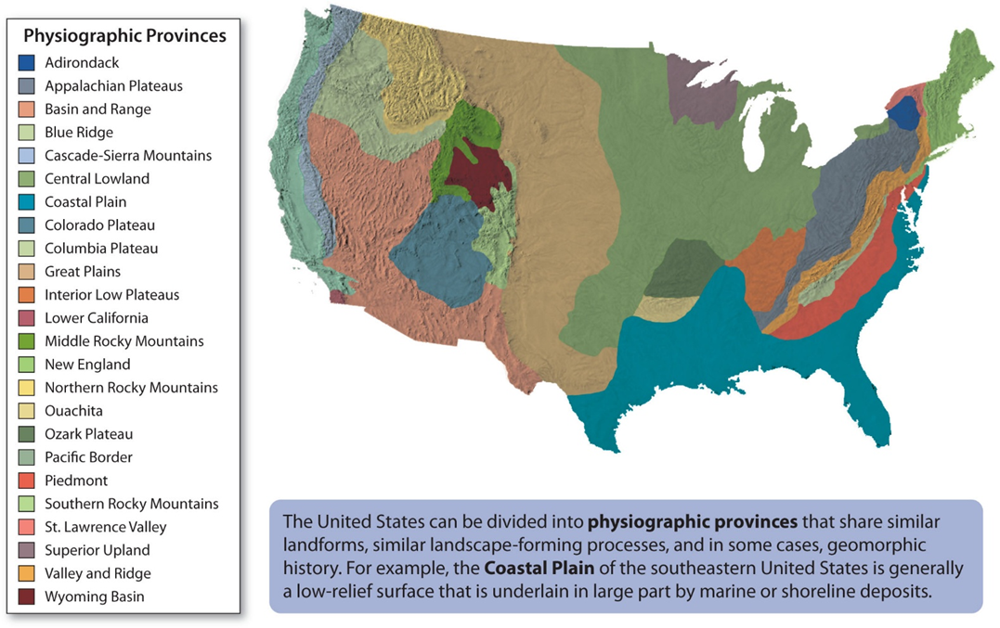
  
- Hydro-: hydrology + geomorphology
- Bio-/eco- (plants or animals)
- Biomorphodynamics: biological-physical feedbacks between animals and plants and physical geomorphic processes
- Anthropo-, submarine, planetary (lots more)
- Exact terms don't matter, conceptual syntheses

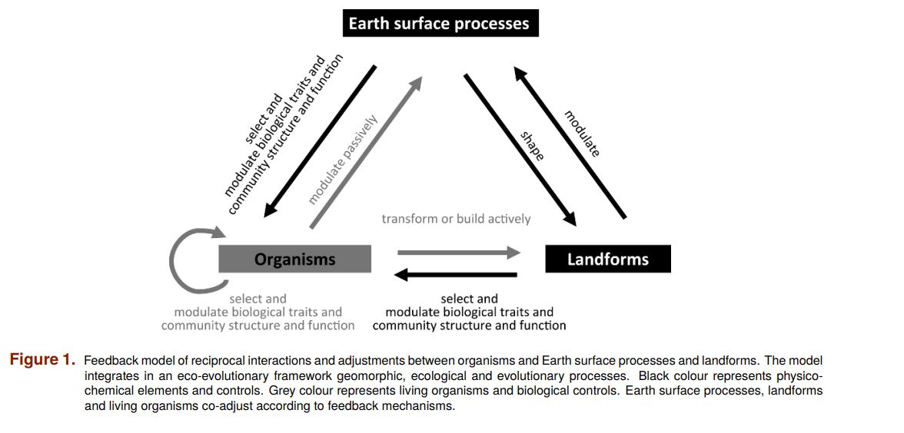

## Methods for Geomorphic Science

**2026-08-28**

Common variables of interest:

- Water velocity and discharge (volumetric flow rate)
    - Classic propeller-meters for 1d measurement
    - Acoustic Doppler Velocimeter for 3d velocity components (at-a-point, time-series)
    - Acoustic Doppler Current Profiler (ADCP): newer, good for larger faster sampling
    - Large-scale particle image velocimetry (LS-PIV): originated as lab method; add some particle and measure its flow
- Channel morphology
    - Width, depth
    - Bed, bedform
    - Bankline delineation, bank roughness
    - Direct field surveying (total station, GPS)
    - Remote sensed: 
    - LiDAR great for "subtracting" vegetation (aerial), also high-res imaging especially vertical (terrestrial, TLS)
    - Drones: morphologic and sedimentological mapping
    - Structure from mapping
    - River bathymetry mapping: LiDAR doesn't work well with water (mostly due to sediment), but Multibeam Echo Sounding (MBES) is high-res, mount on boat and go across river; hydroacoustics, get multiple streams of info about elevation (1000 pings per swath, ADCP only 4); ADCP maps velocities, MBES maps river and coastal beds
- Mapping subsurface
    - Ground Penetrating Radar (GPR): cart pulled across ground
    - Sediment and soil coring: manual hammering or vibracore (vibrating weight on top)
        - Sizing: Dry sieving (Roto-tap) with multiple sieves, gives grain size distribution (proportional masses)
- Numerical Morphodynamic Modelling
- Satellite remote sensing, automated river migration methods

## Basic principles of Geomorphology

**2026-08-31**

- Systems science
    - System: set of interrelated things linked by flows (input-output) and distinct from surrounding environment (input-output cross some boundary)
    - Each geomorphic system (e.g., rivers) is its own system
    - Input minus output = storage change ($I - O = \Delta ST$; Conservation Laws of Mass and Energy)
    - Types of systems:
        - Open: exchange both energy and matter with surrounding environment (most geomorphic systems)
        - Closed: exchange only energy with surrounding environment (global concepts, e.g., hydrological system)
        - Isolated: cannot exchange energy or matter with surrounding environment (theoretical concept)
    - Feedbacks
        - As systems operate, generate outputs that influence aspects of the system---**feedbacks**
        - **Feedback loop**: pathway that information about system travels between various points of system (snowball vs self-regulation)
- Uniformitarianism
    - In late 19th century, shift from catastrophism to uniformitarianism
    - **Catastrophism:** change by sudden, rapid, violent events (doesn't require long periods of time)
    - **Gradualism:** slow, gradual change (long periods of time); introduced by James Hutton in *Theory of the Earth* (1795)
    - **Uniformitarianism:** 
        - laws of physics and natural processes operating today are same as those in past (vast, long geologic history)
        - Charles Lyell in *Principles of Geology* (1830)
        - includes both slow changes and major events (floods, earthquakes)
- Equilibrium, Thresholds & Complex Response 
    - Delicate balance between landforms and processes
    - Always consider driving forces vs resisting forces
    - **Steady-state:** rates of input and output are equal; system maintains time-averaged level
    - **Metastable/Complex Response:** when system reaches some **threshold** (tipping point), it abruptly shifts to a different state which may later reach steady-state equilibrium
    - **Dynamic:** (depends on time scale of interest) appears in steady-state over short term, but there is some trend over long term
    - Evaluating a system's equilibrium condition requires consideration of temporal scale & capabilities to assess change over that time period
- Process-form relationship
    - Mediated by energy, force and resistance (driving vs resisting force)
    - We can view a lot of our systems through the framework of what's trying to do the work and what's trying to hold it in place
- Recurrence Intervals & Magnitude-Frequency relationships
    - Most geomorphic change comes from discrete events of varying size and scale (therefore, magnitude)
    - RI: average time between events of a given magnitude
    - Aug 2016 in Baton Rouge (Lafayette to Slidell): huge flood, magnitude super high (500-1000 year event), but doesn't mean we cannot have similar in the near future
    - Using all these in analyses (especially predicting large events) requires that the system we're modelling doesn't change in properties, but this is generally not the case
- Landscapes based on sensitivity
    - **Insensitive/robust:** steady-state, "buffering", system responds fast to external forces
    - **Sensitive:** slow to response to external forces, or timing of forces faster than response; complex response
    - Landscape Sensitivity based on transient-form ratio (mean recovery time/mean recurrence interval): larger $TF_r$ means more sensitive landscape
    
$$
TF_r = \frac{t_r}{t_d}
$$

# Endogenic Processes & Earth Basics

- **Endogenic:** internal processes related to movement of lithosphere (tectnoics) and/or eruption of molten rock (volcanism)
    - Responsible generally for increasing elevation of landscapes
    - Generally build up (driving force)
    - Larger time scales
- **Exogenic:** external processes related to overall wearing down of landscapes (weather, water, wind, ice)
    - Generally wearing down (resisting force)

## Geologic Time Scale

**2026-09-02**

- Eons --> Eras --> Periods --> Epochs
- Precambrian eon actually has 3 eons, but largely grouped together
- Boundaries based on key events in Earth's history (Earth's physical form, atmospheric composition, evolution/dominance of various forms of life)
    - Precambrian-Phanerozoic boundary represents **Cambrian Explosion**: modern atmospheric composition & variety and complexity of life increased rapidly and enormously (suddenly lots of fossils)
    - Within Phanerozoic, based on extinctions and evolution
    - PT extinction (largest) was due to volcanic activity, not asteroid
- Cenozoic: modern is Palaeogene, Neogene, Quaternary
    - Pleistocene = last glaciation (2.6mya--10kya)
    - Strong push to add Anthropocene Epoch to GTS: when? Weapons of mass destruction (mid-1900s), or *industrialisation*?
        - Only scientific argument against: we don't know what the *lasting evidence* will be, cos no historical record as such to track

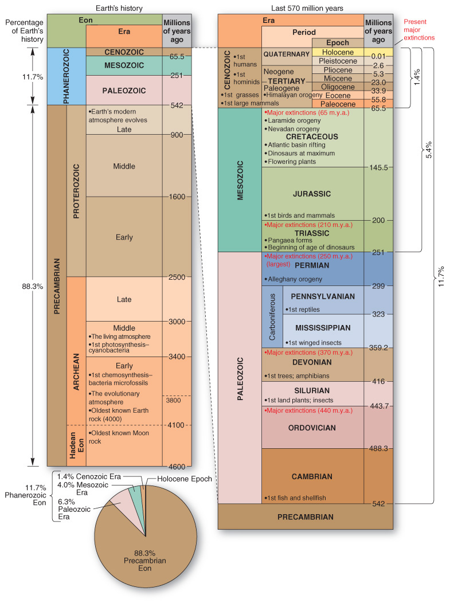

## Earth's interior

- Internal heat drives endogenic processes
- Core (50%): inner is solid iron, outer is molten iron
    - Heat from compaction during formation, and from radioactive decay
    - Heat allows mantle elements to move (mantle convection)
- Non-core:
    - Rigidity: rigid lithosphere (crust + uppermost mantle) vs plastic asthenosphere (transition between rigid upper mantle and rigid uppermost mantle)
    - Density: low density crust vs high density mantle (inc. upper mantle)
- Top 1% is crust: 
    - Continental (granite; thicker; slightly less dense) vs oceanic (basalt; thinner; slightly denser)
    - **Isostasy:** adjustment of asthenosphere to lithosphere based on density-thickness differences; keeps gravity and buoyancy in equilibrium; erosion of crust might result in uplift of plate

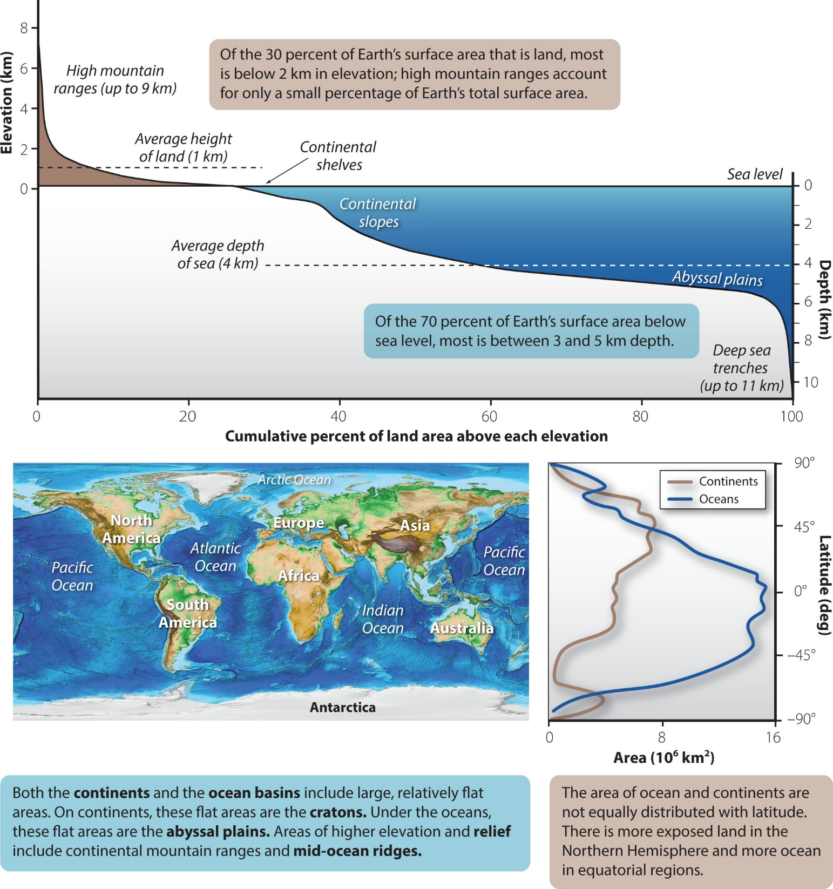

## Plate tectonics

- Seven major tectonic plates
- Only around 1960s correlational evidence among plate shapes, earthquake hotspots, and volcanic activity came together to conceptualise plate tectonics
    - Only after WWII! With more geophysical evidence, pinpoint *how* these movements happen
    - **How:** mantle convection + gravity
    - Earlier concepts thought of continents as icebergs in the oceanic sea
    - But now we know the whole lithospheric crust moves
    - Zero sum game: volcanic activity builds material, on the other end **subduction**
        - Gravity pulls one plate below another through subduction (usually in basaltic ocean crust); mantle convection adds new material atop the crust
- **Tectonic boundaries:** divergent, transform, convergent
- Continent-continent convergent boundaries: **suture zones** (no scope for subduction due to thickness, equal density) resulting in orogeny
- Ocean-continent convergence: subduction due to oceanic being denser and thinner
- Ocean-ocean: older colder (denser) oceanic subducts under younger 
- When plate gets subducted: 
    - Part of it starts melting, becomes less dense, and results in more volcanic activity
    - The higher plate also "scrapes" off subducted plate, either forming some wedge or collecting smaller islands 
- **Bowen's reaction series:** sequence in which minerals crystallise from magma (inversely, melt from rock)
    - High to low temperature increases silica content (earliest rocks formed have lower, latest/youngest have more silica)
    - Silica content determines resistance to breaking down at Earth's surface (more silica, more resistant; e.g., sand on beaches)

**2026-09-04**

Rock type and characteristics (lithology) is important because determines structure and resisting forces; differential weathering produces relief

## Rock types

- Igneous: cooling and solidification of magma/lava
- Metamorphic: transformation of existing rock via pressure and/or heat
- Sedimentary: deposition + subsequent lithification (cementation & compaction) of mineral and/or organic particles
- So it's actually a **rock cycle** 

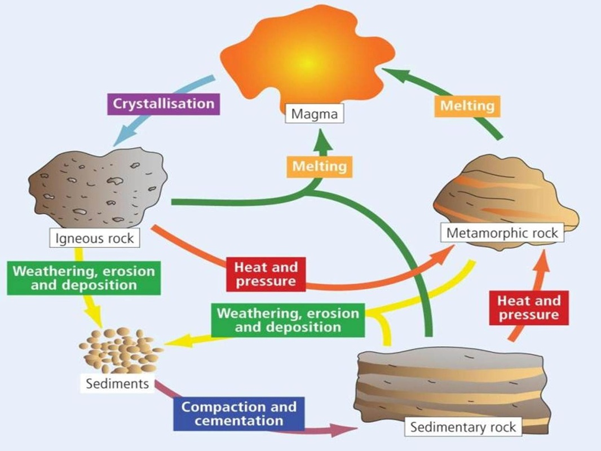

- Majority of rock at Earth's surface is sedimentary, although the crust just below is mostly igneous
- In any given climate, each rock type responds to weather & erosion in a different manner and a different rate
- High-standing landmasses should be underlain by resistant rock, while low-standing formed from rocks more susceptible to erosion
- Climatic factors
    - Insolation
    - Albedo
    - Energy gradients (atmospheric & oceanic circulations)
    - Orographic effects (e.g., rain shadows)

# Tectonic Geomorphology

**2026-09-09**

- Study of landforms and landscapes which recor a measureable tectonic signal
- Typically large scale, but sometimes smaller scale landforms
- Tectonic processes generally elevate rocks above sea level where weathering (exogenic process) prepares rock materials for sculpting into landscapes via erosion (wind, water, ice)
- Can also have lowering of surface (rifting)
- Uplift can occur not just via tectonics but also isostatic rebound

## Uplift & exhumation

- **Rock uplift:** changes in a rock's vertical position relative to a fixed datum (e.g., sea level, t0)
- **Surface uplift:** change in elevation of the land surface relative to fixed datum
- **Exhumation:** unburial of rock below by removal of material above; rock uplift without surface uplift (via surface erosion), mean elevation of landscape remains constant
    - In other words, surface uplift is rock uplift minus exhumation
    
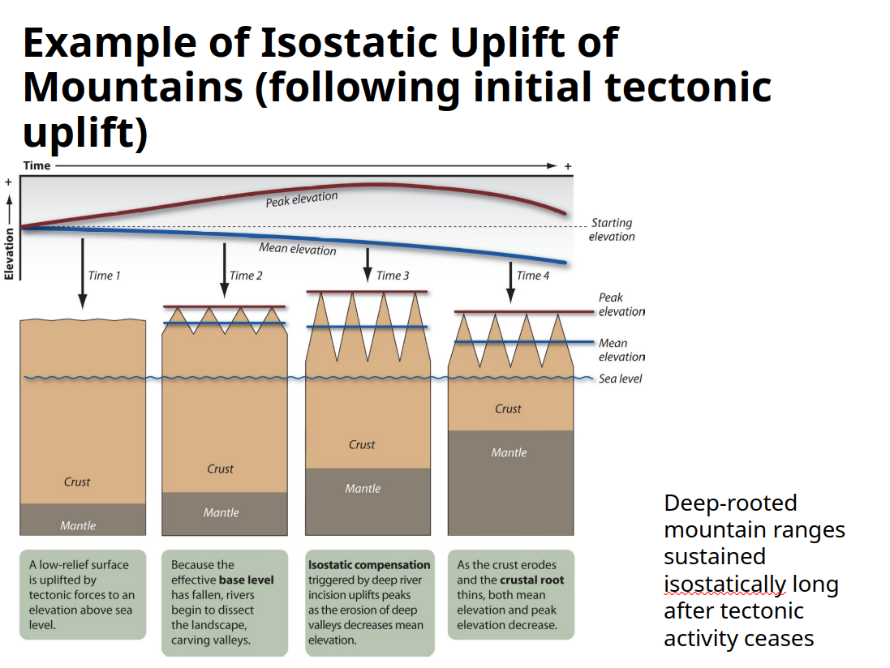

- **Lithospheric flexure:** downwarping directly below load (e.g., mountain, glacier) and (cmpensatory) upwarping away from load; even due to basin sedimentation/loading (continental shelf causes upwarped fluvial terraces; foreland basin at the toe of compressional mountain range)
- **Thermal & density contrasts:** warmer, less dense crust rises above adjacent cooler crust; common with salt domes and diapirs; also rift zones, upwellings/hotspots
- Tectonic landforms dependent on tectonic setting (active, passing, intercontinental), lithology (resistance to erosion), structural geology (degree of fracturing, folding, faulting)

## Faults

- *Displacement* of rocks on either side of a fracture relative to the rocks on the other side (only cracking without displacement called jointing or fracturing)
- Fault plane parameters (both angles):
    - **Dip:** steepness of fault plane
    - **Strike:** orientation of fault plane relative to North
- **Dip-slip faults** mainly vertical motion; **strike-slip faults** usually horizontal with steep dip angle
- **Footwall:** the block *below* fault plane (<90deg); **Hanging wall:** block above fault plane
    - Terms from mining geology: usually lots of ore deposits in fault planes, so miners would hang lanterns on hanging wall and place feet on footwall
- **Normal fault:** footwall goes up, hanging wall goes down (hence a dip-slip, not strike-slip); requires pulling apart, release of pressure (*torsional stress*).
    - Series of normal faults can produces ridges (**horst/range**) and valleys (**graben/basin**); whole state of Nevada characterised by series of normal faults
- **Reverse fault:** footwall goes down, hanging wall goes up; requires pushing together or collision (*compressional stress*)
- **Thrust fault:** very low dip angle, one block rides over another; older rock/material ends up above younger one

### Extensional margins and landforms

 Extensional Landforms (normal faults).
 
- **Fault scarp:** part of fault plane exposed above the surface (normal faults)
    - Over time, weathering and erosion produces triangular facets, eventually back flat (but still older material on top of younger)
    
### Compressional settings and landforms

**2026-09-11**

- Typically involves upward lift, therefore orogeny (mountain building, crustal thickening)
    - Can have volcanism via subduction
    - Suture zones along continental-continental
    - Reverse & thrust faults
    - Folding

### Transform settings and landforms

- Transform boundaries are typically not perfectly straight, so can involve mix of compression and extension
    - Transtensional (releasing bend): results in grabens (valleys), drops in landscape; pull-apart basins
    - Transpressional (restraining bend): fault-zone parallel mountains; surface uplift via thrust faults
- Results in:
    - Offset channels or beheaded streams
    - Other offsets, like in built-up area
- Strike-slip fault direction: imagine on one block, then which direction has other block moved? (right-lateral, left-lateral)

## Folds

- Structural landforms: Differential weathering after tectonically uplifted rock declines or ceases
    - Folds and faults warp strata, weakening resistance to erosion, and bring different lithologies together in new proximity
- Fast force & brittle material: fault; slow force & ductile/sturdy material: fold; but needs to be *compression*
- **Anticline:** upfold/arch/buckle upward
- **Syncline:** downfold/trough/bow downward
- Both often found together
- When anticline/syncline happens followed by erosion, we get symmetric/concentric patterns at ground level (looking down)
    - Oldest in centre, youngest in outer---anticline
    - Youngest in centre, oldest in outer---syncline
- Anticline not necessarily higher than syncline; determined by resistance to erosion of material, and among the layers as well
    - Fold does not dictate topography, resistance of rock does
- **Monocline:** only one portion of rock layers folds down; normal faults deep down, but upper material more ductile, so folds together in one direction
    - Cuesta (<45deg), hogback (45deg), flatiron (>45deg)
- **Plunging folds:** when compressional force is not perpendicular to material, creates anticlines or synclines with dips
    - Anticlines V in direction of plunge; Synclines open in direction of plunge
    

### Arches National Park

<iframe title="Video Embed" src="https://www.nps.gov/media/video/embed.htm?id=285EAB03-155D-451F-675A179E29B97247" width="720" height="480" frameborder="0" scrolling="auto" allowfullscreen></iframe>

### Buttes & mesas

- Resistant cap rock, everything else weathered down

# Volcanic Geomorphology

**2026-09-14**

## Importance of igneous (volcanic) processes

- Main way to add crust (intrusive [stays underground] or extrusive volcanism)
- Through volcanism, changing the shape of Earth's surface (= geomorphology)
- Emitting gases that change weather & climate
- Effects on other systems: rivers, coasts, biosphere (ecological succession)

## Distribution & styles of volcanism

- Along plate boundaries (divergent boundaries, subduction zones at convergent boundaries) or within plates at hotspots (e.g., Hawaii)
    - All volcanism at divergent boundaries are extrusive (spreading centres); shallow earthquakes and volcanism
    - Convergent boundaries have deeper earthquakes/volcanism; can be oceanic-oceanic or oceanic-continental
    - Hotspots: spatially fixed in mantle (mantle plumes), and plate moves over, causing volcanism; old-young gradient of volcanoes

## Magma chemistry

- Igneous rock
    - **Large crystal:** slower cooling, crystals visible without microscope (coarse grain); cooling must have been underground
    - **Small crystal:** faster cooling, crystals invisible without microscope (fine grain)
    - **Glassy/vesicular crystal:** very fast, extrusive cooling (obsidian or pumice styles)
- Magma underground becomes lava aboveground
- Deeper in the ground --> slower cooling rocks
- **Malic:** magnesium & ferric; **Felsic:** feldspar & silica
- Most of oceanic crust high density (basalt), most of continental low density, silica-rich (granite)
- Lava viscosity
    - Measure of fluid's resistance to deformation; how much does it flow?
    - More silica --> more viscous (thicker)
    - **Explosivity:** high viscosity prevents escape of gases, building pressure, so greater explosivity
    - **Yield strength:** ability to resist flowing; when flow stops, shear stress (driving force) balanced by yield strength (resisting force)
    - Basaltic lava: mafic, low silica content; "aa" ([rough, jagged](https://www.youtube.com/watch?v=iyIV5fd1Aww )) or "pahoehoe" ([ropy cords](https://www.youtube.com/watch?v=v1h_BJA4QJU))
    - Volcanic Explosivity Index (VEI): logarithmic; consider volume of fragmented ejecta (not lava)

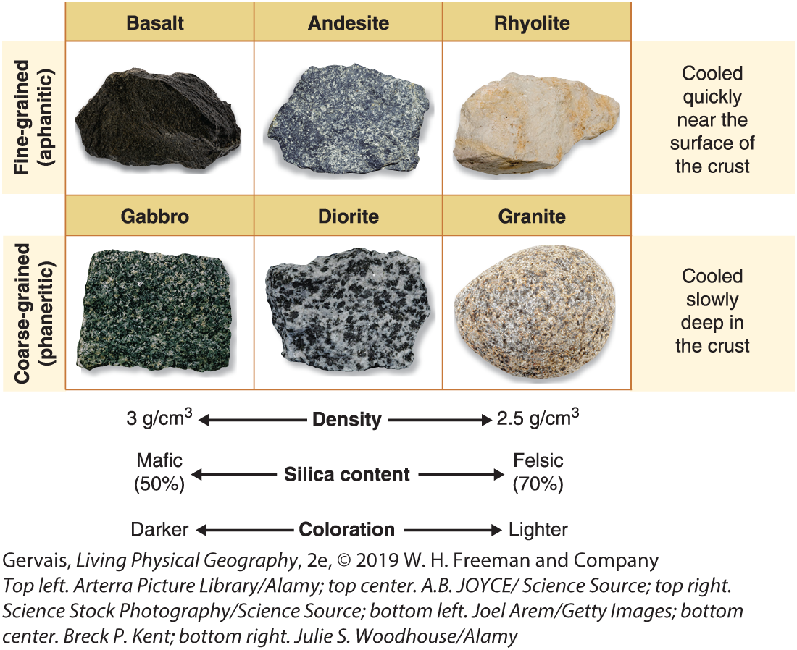

VEI of 4:

<iframe width="560" height="315" src="https://www.youtube.com/embed/BUREX8aFbMs?si=pMMTYBpeB18x28ve" title="YouTube video player" frameborder="0" allow="accelerometer; autoplay; clipboard-write; encrypted-media; gyroscope; picture-in-picture; web-share" referrerpolicy="strict-origin-when-cross-origin" allowfullscreen></iframe>

## Volcanic landscapes & morphology

- Eruptive products: lava flows, pyroclastic material, volcanic gases
- Flood basalts: extensive sheets of basaltic lava
    - Over long time, up to millions of years
- Shield: effusive eruptions (basaltic lava), gentle slopes
- Cinder cone: small accumulation of pyroclastics (scoria) from moderately explosive eruptions
    - Typically basaltic; short-lived (erupt only once)
    - Combination of flows & pyroclastic ejecta
- Composite: mountain produced by series of explosive eruptions of lava, ash, rock, and pyroclastics
- Caldera: collapsed summit following eruption or loss of magma
- Dike: vertical intrusions through rock layers
- Sill: horizontal intrusions between rock layers

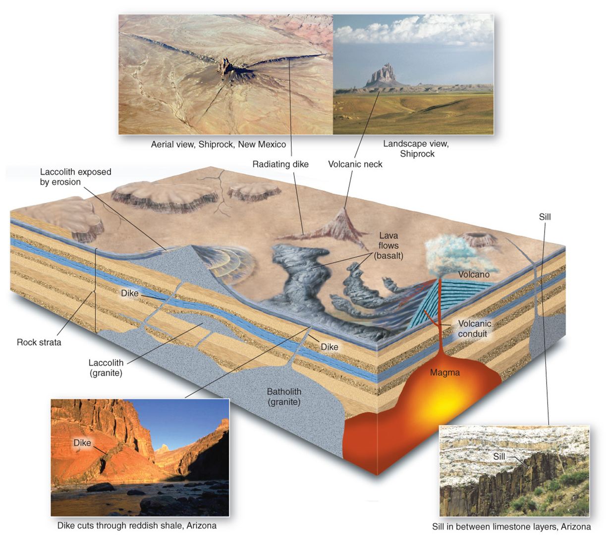
    
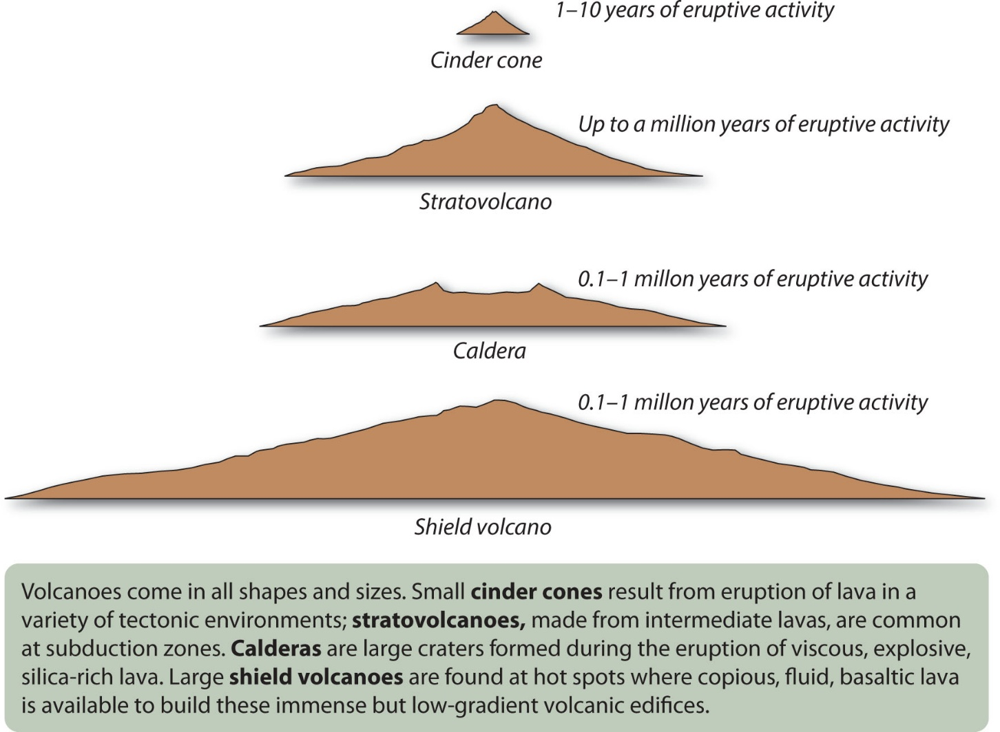

Mount St Helens:

<iframe width="560" height="315" src="https://www.youtube.com/embed/h6B1myUKAS4?si=ZuTrc7QS8fB4Kce4" title="YouTube video player" frameborder="0" allow="accelerometer; autoplay; clipboard-write; encrypted-media; gyroscope; picture-in-picture; web-share" referrerpolicy="strict-origin-when-cross-origin" allowfullscreen></iframe>

# Physical & Chemical Weathering

**2026-09-21** (missed Friday lecture)

- In geomorphology, exogenic vs endogenic refers more to the *origin* of the processes driving the formation of landforms (not the formation or occurrence)
- **Weathering:** breakdown of materials, from both physical (mechanical) and chemical processes
- **Erosion:** transport of weathered materials to different locations (movement) by a *fluid* medium (air/water)
- **Denudation:** any process that *wears away* landforms, resulting in decreasing the elevation and relief of a landscape (lowering the Earth's surface)
    - Include weathering, mass movement, erosion 
    - Counteracts processes like faulting and folding, which increase elevation and relief
    
## Weathering

- Physical and chemical processes that break down rock at or near Earth's surface
- Some consider biological, but these can themselves be explained by physical/chemical
- Weathering occurs because rocks are exposed to very different conditions (temperature, pressure, air/water exposure) than where they were formed
- **Mineral stability:**
    - General susceptibility of rock-forming minerals to weathering --> inverse of sequence of formation deep within Earth (**Goldich's Weathering Series**, opposite of Bowen's Reaction Series)
    - Mineral complexity or crystalline structure: 
        - Complex ionic bonds weaker than simple covalent bonds
        - SiO~2~ (quartz) very stable
        - ZrSiO~4~ (zircon) very stable, despite very high melting temperature

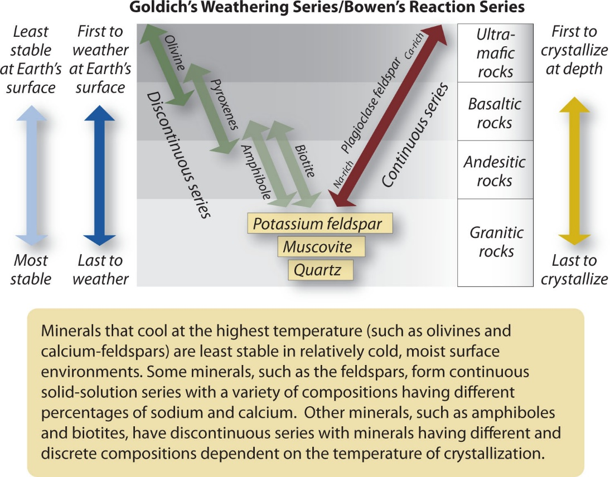

### Physical weathering

- Mechanically break the rock into smaller pieces (*disaggregation*), eventually until those particles have uniform mineral composition… then continue to reduce the size of those particles
- No change to composition of parent material
- Can occur on any **type of Earth materials (inorganic)**:
    - **Bedrock:** consolidated rock
    - **Regolith:** loose layer of material covering solid bedrock
    - **Parent material:** consolidated or unconsolidated material from which regolith or soils develop

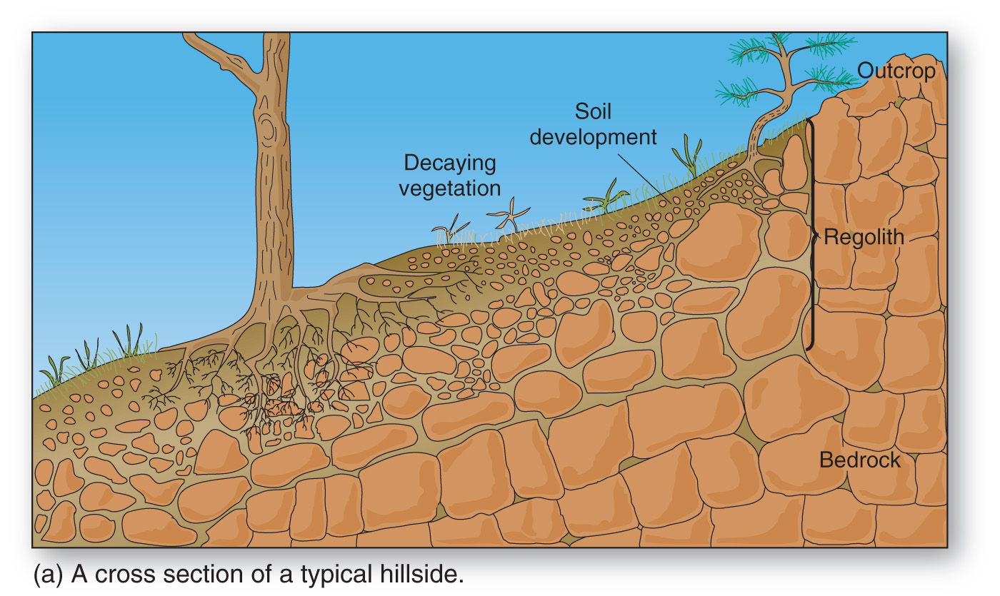

- Types/causes of physical weathering:
    - Pressure-release jointing (fracturing): 
        - Overburden covering buried rocks gradually removed by erosion, reduces confining pressure on rock, rock expands and fractures
        - Occurs concentrically and parallel to rock surface
        - **Sheeting/exfoliation:** removal of slabs of rock along joints
        - **Exfoliation dome:** landform produced when sheeting occurs in concentric shells; common in intrusive igneous rocks like granite (e.g., Half Dome in Yosemite)
    - Growth in voids: substance grows or increases volume within cavities or fractures, generates tensional stresses that may enlarge the opening or split the rock
        - Freeze-thaw (frost wedging): water expands when freezes (9%); prevalent in cold climaets where temperature fluctuates around freezing
        - Salt crystal growth: evaporation of salty water leaves behind salt; prevalent along coasts and in arid environments; causes honeycomb weathering
    - Thermal Stress: 
        - Expansion & contraction cycles by insolation/fire
        - Some minerals expand more than others (*thermal conductivity*); rock separates in concentric shallow layers
        - But most rocks/minerals have low conductivity, heat rarely transfers > few cm into the rock; then results in **spalling** (breaking away of top layer)
    - Bioturbation:
        - Disturbance of sedimentary deposits by living organisms
        - Burrowing organisms excavate and mix earth materials
    - Vegetation: Root growth in joints and soil
    - Cavitation: 
        - Formation then collapse of high-temperature air bubbles due to vaporisation of water --> sends shockwaves and blast surfaces
        - Pistol shrimp!
        - Happens when water forced to move at very high speeds; in geological settings, perhaps rare?

<iframe width="560" height="315" src="https://www.youtube.com/embed/yAZ1V_DJKV8?si=Z3st-Y9uOjMA99qS" title="YouTube video player" frameborder="0" allow="accelerometer; autoplay; clipboard-write; encrypted-media; gyroscope; picture-in-picture; web-share" referrerpolicy="strict-origin-when-cross-origin" allowfullscreen></iframe>

### Chemical weathering

- Rock broken down by *chemical alteration* through reactions between minerals, air, water
- Water: powerful solvent ("universal solvent")
    - Even more powerful when CO~2~ dissolved in water (becomes weakly acidic)
- Minerals: may combine with O~2~ (oxidation, rust) from atmosphere
- Reactions change primary rock-forming minerals into secondary minerals (e.g., clays), and some elements lost in solution to surface water and groundwater
    - Essential processes for biosphere (release of nutrients)
- **Saprolite:** Chemically weathered, "rotten" rock that forms directly on top of intact bedrock

#### Oxidation & reduction

- Transfer of electrons from one element to another, resulting in change in valence of primary constituents
- Oxidation: loss of electron (weakens mineral); reduction: gain of electron
- Redox potential (Eh): capacity of oxidation to occur (property of soil); higher Eh indicate soil with greater affinity for electrons (tendency for oxidation of minerals into soil)
- Pyrite (fools' gold, iron disulphide) is commonly associated with coal deposits; results in *acid mine drainage* when pH rises above 3, precipitating iron oxide
    - Abandoned mine drainage treatment: [see example](https://youtu.be/GCn3g0T1qys?si=d5xnmb4Kp2umAgpw)

#### Solution/dissolution

- Transfer of mass from solid to aqueous state
- **Congruent dissolution:** all constituents of individual molecule separated and remain in solution
- **Incongruent:** some released ions recombine to create new compounds and secondary minerals
- Calcite dissolution is reversible: as broken down carbonates travel further down and if they reach some underground cavity, conditions different (evaporation, increased pH, decreased CO~2~), and they precipitate calcite again (cave geomorphology, speleothems)

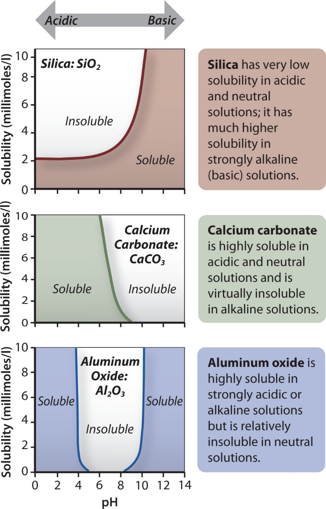

#### Hydrolysis

- Minerals combine with water to form new compounds; **not reversible**
- Important for silicate minerals (e.g., granite)
- Causes granulation and produces secondary clay minerals
- Aluminosilicate + water --> clay mineral + cation + silicic acid
- **Clay formation and mineralogy:**
    - Clay minerals are layered silicates; sheets of alumina octahedral and silica tetrahedral in either 1:1 or 1:2 structure
    - TOT structure has weaker bonds, due to T-T sheet connections, so greater area for processes
    - Shrink/swell clays: shrink when dry and expand when wet
    - Lateritic residuum: mineral at the end of weathering sequence; signifies long weathering process and low soil fertility

#### Hydration

- Incorporation of water molecules into crystal structure of minerals
- Sometimes considered as physical weather, but here consider as chemical because occurs at lattice level
- **Reversible**
- Gypsum vs anhydrite: gypsum very soft, anhydrite much harder

### Factors affecting weathering

- Climate: temperature & moisture
- Rock composition/structure
- Presence/absence of joints/fractures: teamwork of initial physical that increases surface area for chemical to work on and round off sharp edges (**spheroidal weathering**)
- Vegetation: root wedging (physical) + organic acids (chemical)
- Geographic orientation: relative to sun
    - N-facing slopes in N hemisphere cooler, moister, more vegetated (different species)
- Global change

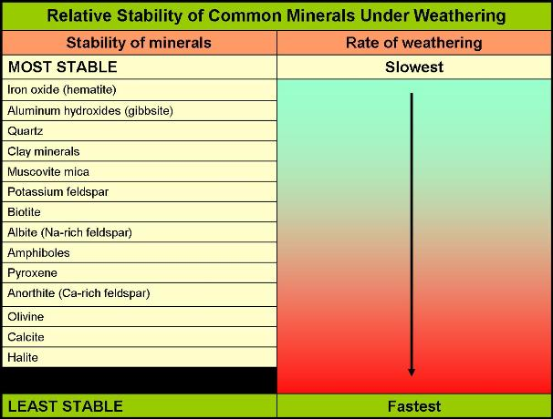

## Karst landscapes & caves

**2026-09-23**

- Limestone and marble (metamorphosed limestone) dissolve easily in weakly acidic environments; carbonic acid abundant in environment (H^+^ and CO~2~)
    - Depends on partial pressure of CO~2~, so soil water highly effective
- **Karst:** distinctive landscape that forms from highly soluble rocks, usually limestone (i.e., *carbonate rocks*)
    - Unique drainage pattern resulting from karst processes
    - Slavic-Italian (*kras-carso*): bleak waterless place, or bare rock surface
    - When water falls on surface, tends to go belowground quickly
    - Classical description from high Kras plateau near Adriatic Sea, Slovenia; closed depressions, interrupted stream valleys
    - Much broader term now; about 15% of Earth's land area has karst features
    - Louisiana has no limestone, but some halite landscapes; considered evaporite, together with gypsum
    - Dolomite (MgCO~3~) has Mg instead of Ca
    
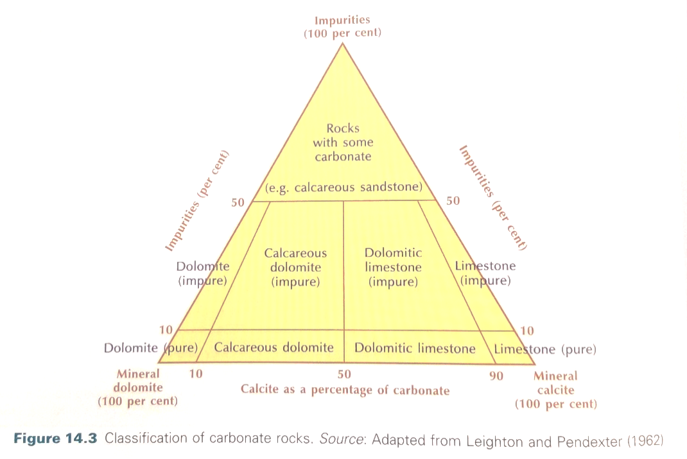

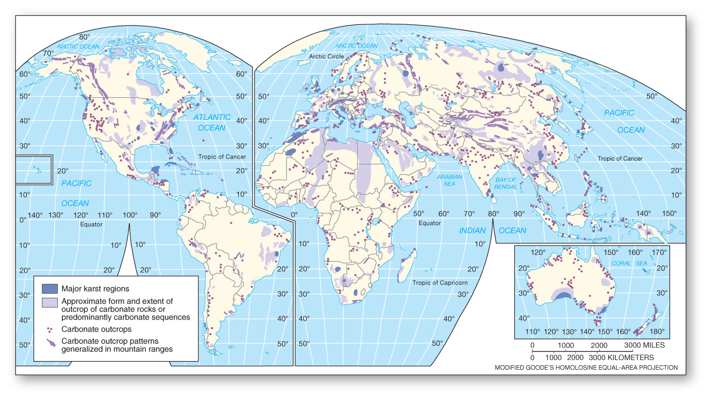

### Karst landforms

- **Karren:** umbrella term; small-scale solutional features on carbonates surfaces exposed at ground surface or in caves
- **Closed depressions:** aka sinkhole; shallow depressions that form from dissolution near (on or below) the surface
    - Solutional (top-down) vs collapse (bottom-up)
    - Sinkholes (dolines)/collapse can be very destructive 
        - Florida is sinkhole alley ([old news](https://youtu.be/WuMFT97sTSE?si=PpCkjXeQuDswKym4))
        - Lake Peigneur, LA ([swallowed a lake](https://youtu.be/CmHpNTYYWcM?si=e0kGviYAH_7cXTZt))
        - Salt drilling: no need to mine underground, just pump water underground, dissolve salt, then pump back out
- **Grotto:** natural caves near coast/water
- **Solution valley:** series of connected sinkholes
- **Disappearing streams:** water enters cavity and flows underground

### Tropical karst landscapes

- More precipitation; more soil and vegetation, warmer temperatures
- **Cockpit karst:** like closed depressions, but more pronounced hills between (top-down)
- **Tower karst:** steep-sided, may not have vegetation (e.g., Guilin, China)

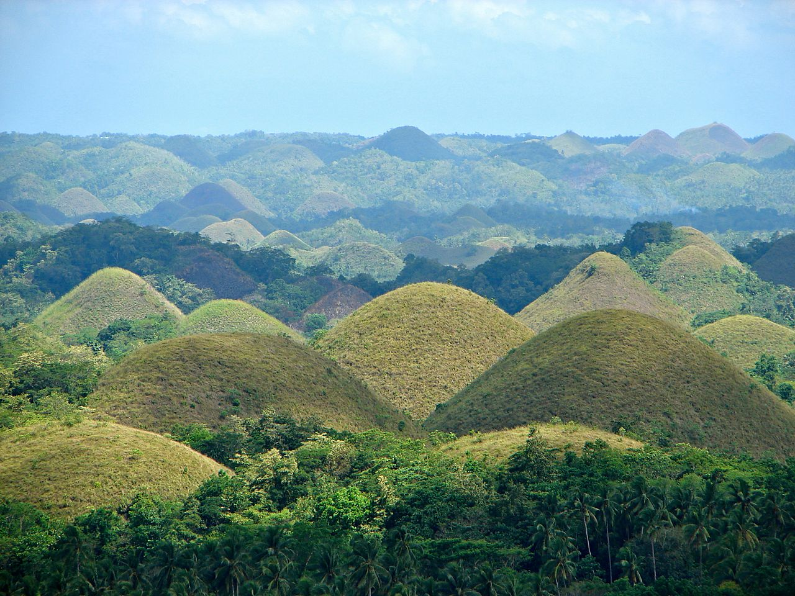

### Caves and speleothems

- **Speleothem:** secondary mineral deposit
- Typically limestone, dolomite, gypsum
- Stalactites (ceiling), stalagmites (ground)
- Different shapes
- Other acids can form as well: sulphuric acid dissolving limestone, and precipitating to calcium sulphate (gypsum). e.g., Carlsbad Caverns in NM

<iframe width="560" height="315" src="https://www.youtube.com/embed/wgUFb_l4DLE?si=KGSg1fWSQN3euvUN" title="YouTube video player" frameborder="0" allow="accelerometer; autoplay; clipboard-write; encrypted-media; gyroscope; picture-in-picture; web-share" referrerpolicy="strict-origin-when-cross-origin" allowfullscreen></iframe>

# Soil Geomorphology

**2026-09-25**

- How is soil different from just sediment?
    - Inorganic vs organic
    - **Regolith:** layer of fragmented, unconsolidated mineral and rock, either residual or transported, that occurs almost everywhere
    - **Soil:** *chemically and mechanically weathered* and/or altered regolith capable of sustaining plant life. Dynamic system composed of fine organic and mineral fragments which interacts with plants, animals, water, humans...
    - 50% mineral + organic matter, 50% air + water in pore space
    - Darker --> more organic content
    - *Open system:* inputs (insolation, water, rock/sediment, microorganisms) and outputs (plant ecosystems, filtered water, nutrients)
- Basis for ecosystem function:
    - Retain and filter water
    - Habitat for microbial organisms and others
    - Source for slow-release of nutrients
    - Storage sink for carbon: soil carbon pool 3 times larger than atmospheric carbon pool!
    - ~2/3 recent increase in atmospheric carbon comes directly from burning fossil-fuels, ~1/3 comes from loss of soil
    - Desertification
- Soil forming factors (Hans Jenny): CLORPT (climate, organisms, relief, parent material, time)
    - Climate: greater moisture and temperatue --> faster chemical weathering
    - Relief: slope, elevation, orientation. High slope: more erosion, thinner layers with less organic matter. Elevation: temperature & precipitation. Orientation: effective insolation. 
    - Time: takes 200-1000 years for 1 inch of soil to form
    - Could also add H for Humans: climate change, fertilisers, intensive agriculture, etc.
- Soil production: rate at which bedrock broken down into erodible material forming soil
    - Depends on soil residence time (between mineral grain's initial weathering to erosion/removal from slope)
    - Soil thickness depends on equilbrium between soil production (rock weathering) and soil erosion (transport)
    - Steepest slopes typically have poor soils, while the base of that slope receives that eroded soil and has great soils
    - **Regolith production:** in many landscapes, production rate exponentially decreases with depth/thickness of existing regolith (separation from atmosphere). On the other hand, in landscapes where regolith production more strongly controlled by regolith water content (chemical weathering processes), the peak may be at intermediate cover thickness, so might get a right-skewed pattern.

## Basic terminology

- **Pedon:** smallest unit of soil that represents all the characteristics and variability used for classification (volume)
- **Soil profile:** vertical section from surface to the deepest extent of plant roots or to the point where regolith or bedrock is encountered
- **Soil horizons:** distinct horizontal layers organized within the soil profile
- **Solum:** true definable soil (horizons A, E, B) in a profile, without regolith/bedrock below

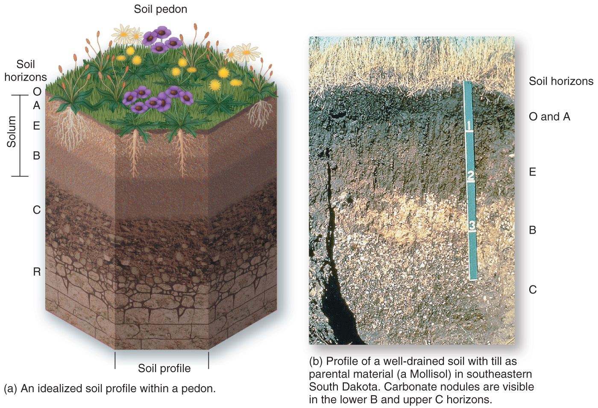

## Soil Properties

- Colour
    - Suggests composition and chemical makeup, but can de deceptive
    - Use hue, value, chroma
    - Munsell Color Chart (175 colours)
- Texture 
    - Distribution/proportion of particle sizes (inorganic/mineral sizes) within soil
    - Anything >2 mm is not soil, it's gravel or larger
    - So how much sand, silt and clay proportionally? Sieve analysis
    - **Loam:** somewhat even mix of sand, silt, clay
    
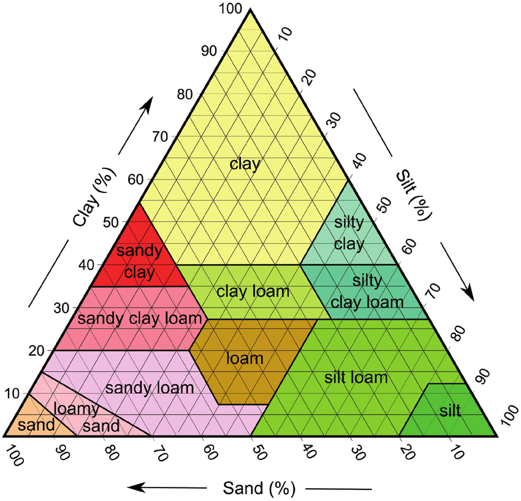

- Structure
    - Size and shape of aggregates of soil particles
    - Smallest natural lump/cluster is called **ped**
    - Shape of peds determines structure type (crumn/granular, platy, blocky, prismatic, columnar)
    - How peds separate determines porosity (rounded peds more pore space, greater permeability, better for plant growth)
- Consistency
    - Cohesion of soil particles
    - Product of texture (particle size) and structure (ped shape)
    - Resistance to breaking and manipulation under varying moisture
    - Wet, plasticity, friable, firm
- Porosity
    - Measure of empty spaces in soil; ratio of empty (pore) volume to total volume
    - Permeability: connectedness of pore spaces
- Moisture
    - Somewhat vague; definition depends on discipline
    - Soil scientists: water in pore spaces (field capacity, wilting point, capillary action)
    Hygroscopic water – inaccessible to plants, molecule-thin layer
    - **Capillary water:** water held by surface tension between particles against gravity, available for plants
    - **Field capacity:** amount of water remaining in the soil a few days (48 hours) after rainfall and percolation has ceased
    - **Wilting point:** only hygroscopic water remains in soil
    - **Available water capacity (AWC):** total quantity of water that can be held in a soil for plants
    - Capillary water is more important for plants than gravitational water, so need greatest time between field capacity and wilting point
    
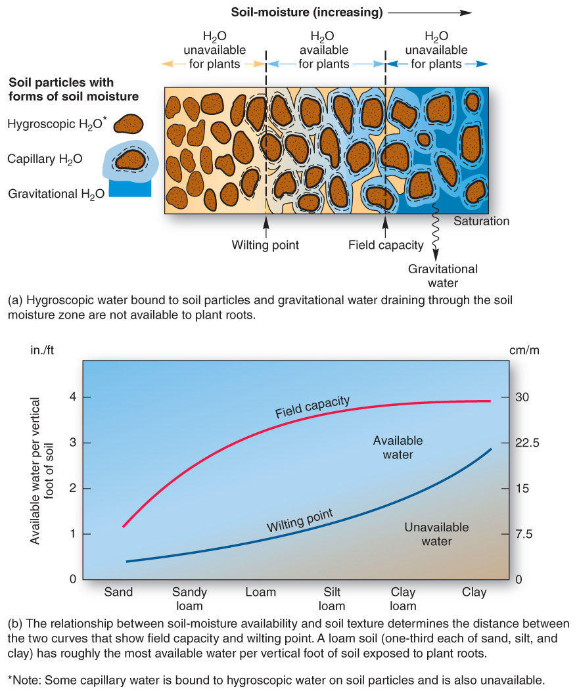

- Chemistry
    - Involves air and water; "atmosphere" inside pedon mostly N, O and CO~2~
    - Water in soil pores is called **soil solution** and is where chemical reactions occur
    - **Cation exchange capacity (CEC):** 
        - **Base saturation:** degree to which exchangeable sites occupied by cations other than H^+^ and Al^3+^ (low base saturation --> reduced soil fertility)
        - Strongly acid pore fluid allows H^+^ to replace metal cations (reduces number of potentially exchangeable cations)

## Soil horizons

O --> A --> E -> B --> C --> R (all not always present, but order remains)

Lowercase letters can be used as modifiers for each master layer

### O: Organic

- Top of soil profile; humus (organic matter from plants and animals)
- Dark, mix of organic matter + bacteria and other organisms processing it
- >30% organic matter

### A: Topsoil

- Humus and clays crucial components
- Links soil nutrients and plants using them
- Darker (organic content), evidence of bioturbation

### E: Eluviation

- Coarse sand, silt; generally more resistant material
- Lighter coloured (maybe white): irons, aluminium, other mineral/organic matter has been *leached out* by water
- **Eluviation** is an erosional process: leaching (mobile ions) + translocation of solid material
- Usually found in older, acidic soils

### B horizon

- Accumulation of clays, aluminium, irons, etc. from layers above
- **Illuvation:** deposition/accumulation process
- Reddish or yellow coloured due to illuviated minerals (silicates, iron, carbonates, gypsum)
- A-E-B is defined as *solum*

### C horizon

- Weathered bedrock
- Parent rock only slightly altered here
- Lies outside biological influences of solum

### R: Rock

- Bottom of soil profile
- Consolidated or unconsolidated (loose) rock

## Pedogenic processes (soil development)

### Laterisation

- Intense leaching & oxidation in well-drained soils in wet climates
- Organic accumulation is limited
- Eluviation of minerals, including silica, but leaves behind Fe and Al hydroxides
- Long time period

### Podzolisation

- Cool and moist climate, acidic organic litter
- Heavy leaching even removes Fe, Al and other organic matter from A and accumulate in B
- Heavy podzolisation produces defined E horizon

### Calcification

- In climates where PET > precipitation
- Illuviated calcium carbonates in B/C horizons 
- Three steps for calcium accumulation
- Common in subhumid--hyperarid environments (drylands)

### Salinisation

- Concentration of salts in soil, limiting plant growth
- Common in coastal areas and/or intense agriculture

### Gleisation

- Water-saturated layer of bluish gray clay 
- Indicates poor drainage and lack of oxygen
- Common in cold, wet climates, and poor drainage conditions

## Soil Classification

Soil Order Taxonomy (12 Orders)

1. Mineral vs organic (>25% organic matter)
2. Weathering: little weathering, moderate weathering, highly weathered
3. Horizons
4. Moisture levels, minerals, parent material ...

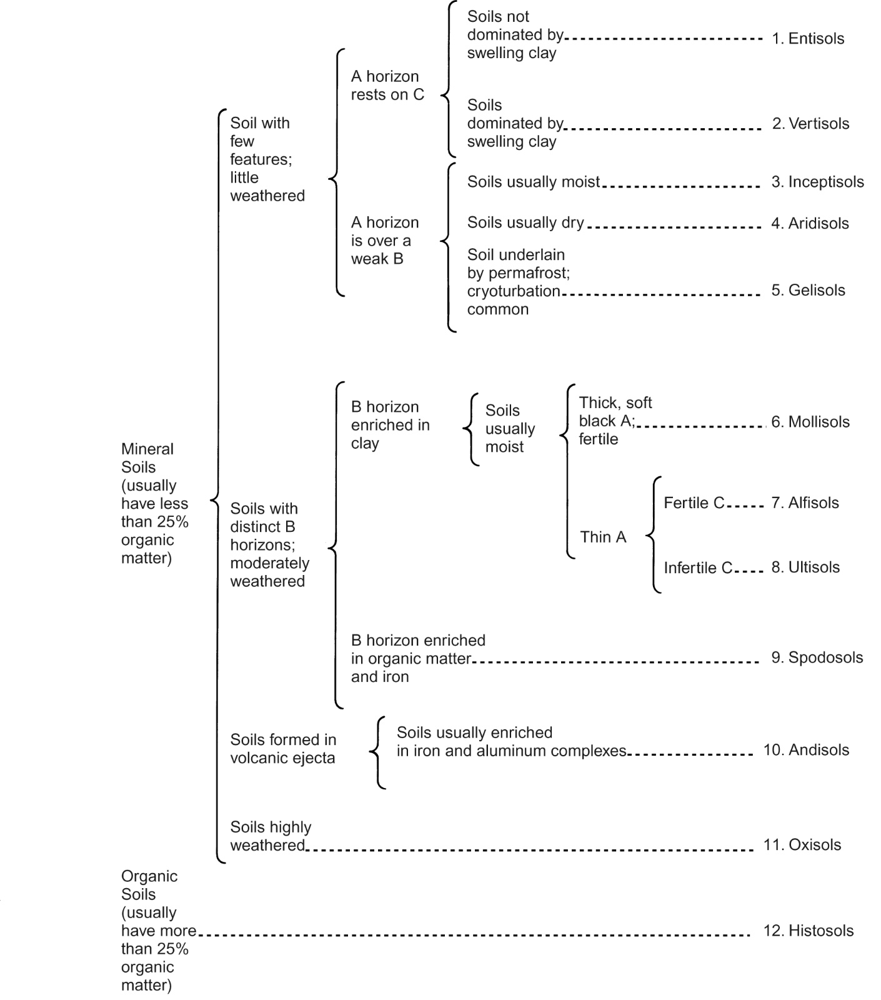

Indian dryland soils not like Chaco dryland soils!

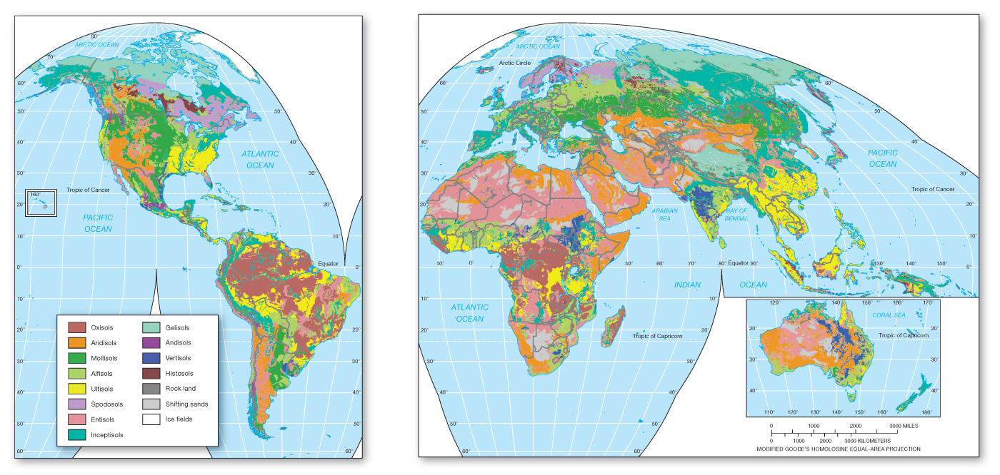

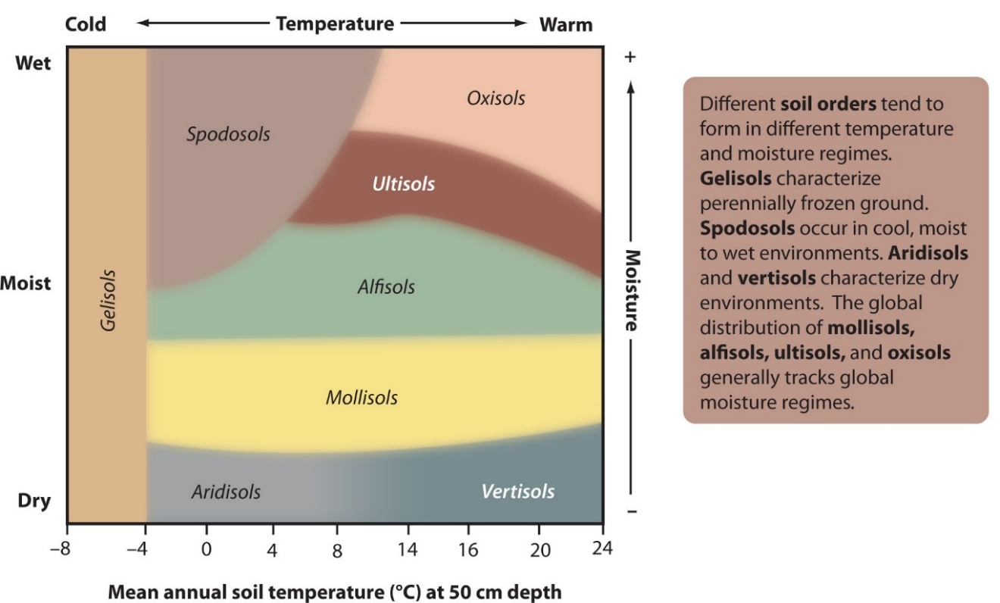

Climate and vegetation:

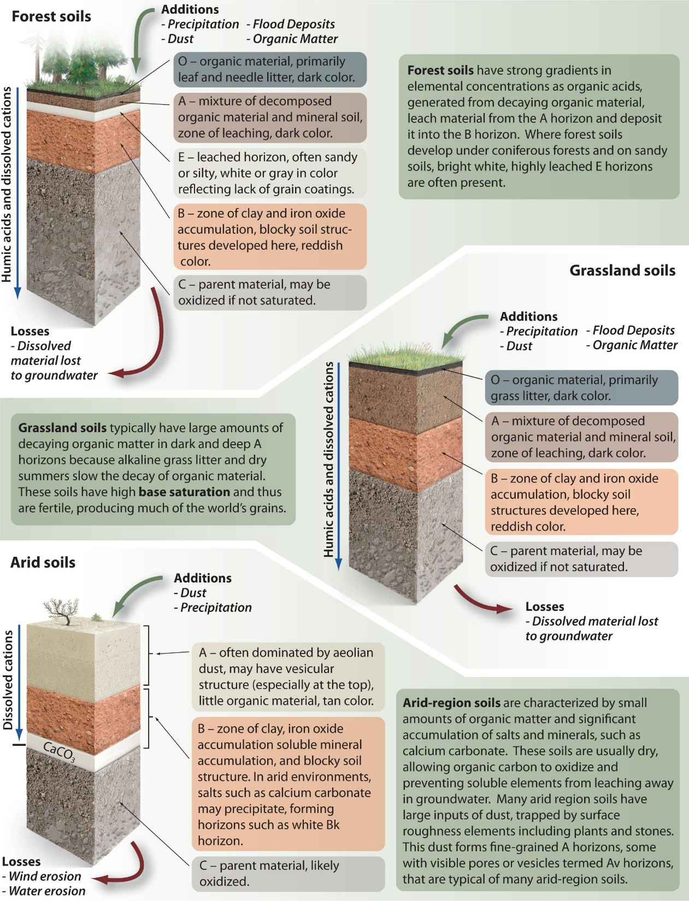

### Oxisol

- Dominated by *laterisation*
- High temperature & moisture
- Well developed (long period of time), well drained
- *"Tropical soils"*/tropical rainforest soil
- Very delicate: high eluviation removes basic cations and colloidal material to lower illuviated horizons, so low CEC and fertility
- Agricultural practices like slash and burn enrich with organics, but do not last long (high precipitation, leaching, well drained)
- *Laterites:* hardened soil of residual Fe and Al oxides

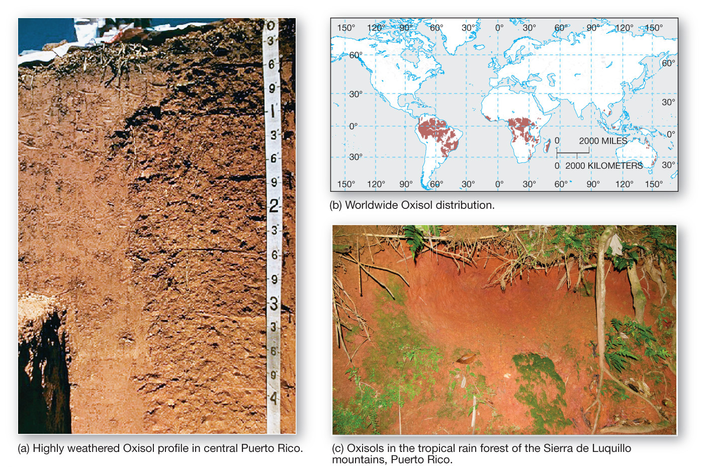

### Spodosol

- Dominated by *podzolisation*
- Humid temperate climates
- Northern coniferous soils
- Forest plant materials make acidic soils
- Agriculture: requires addition of N, K, limestone

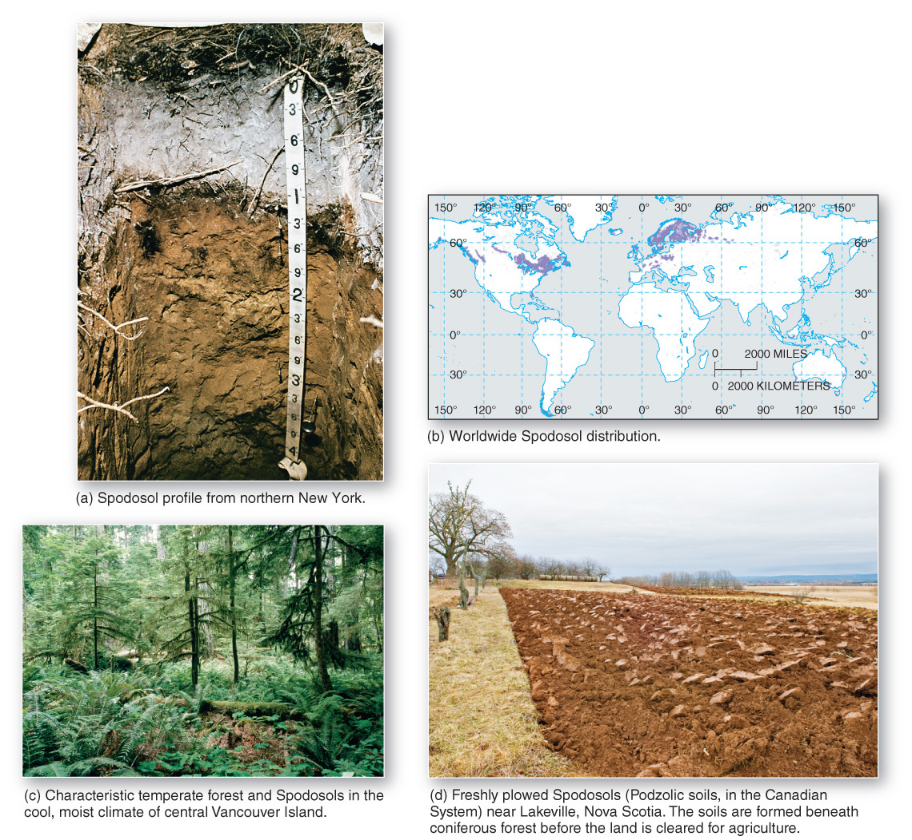

### Mollisol

- Dominated by *calcification*
- Temperate grassland soils
- Thick dark organic surface layer (humus-rich), high CEC & fertility
    - Grass roots dense and deep, but too cold in winter and too dry in summer for full decomposition
- Good for agriculture

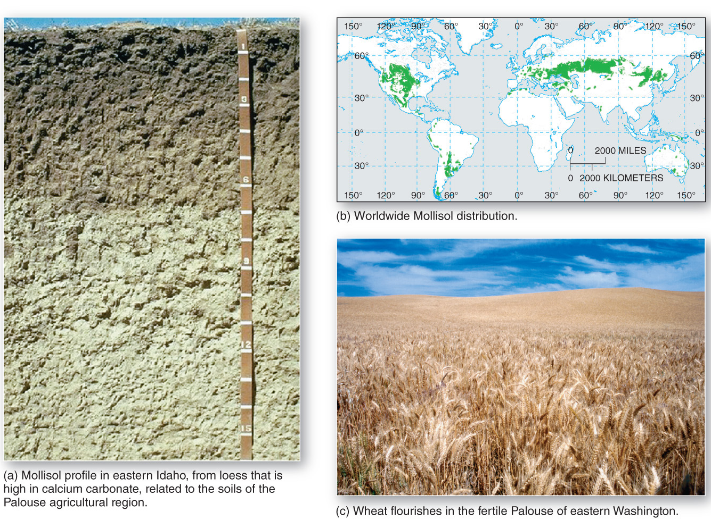

### Alfisol

- Forest soil, but moderately weathered
    - (Forest version of mollisol, in a way)
- More acidic than grassland organic matter
- Thin A horizons
- Greyish brown to reddish colour
- Moderate base saturation

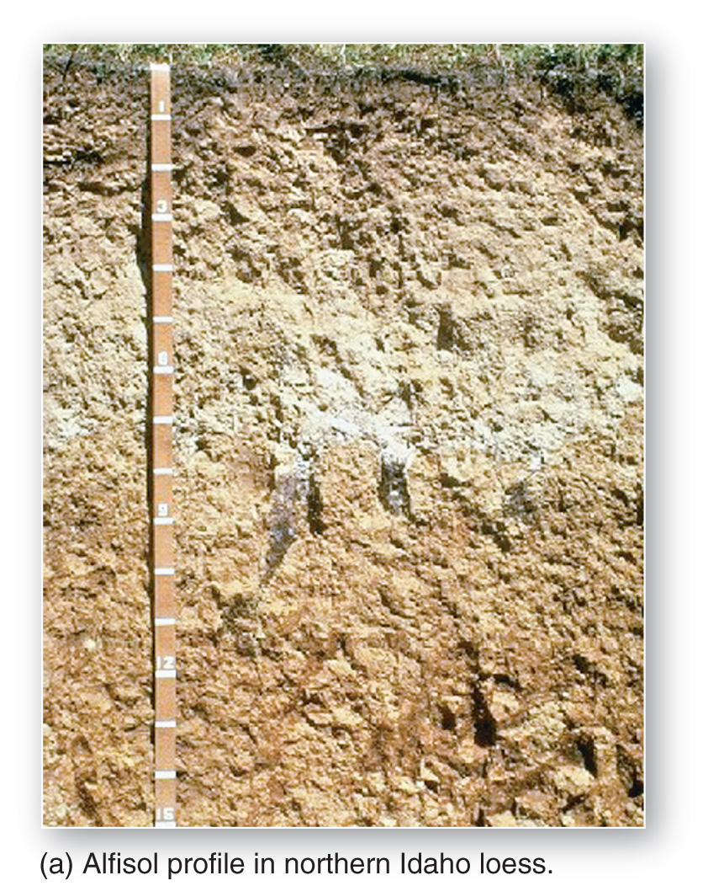
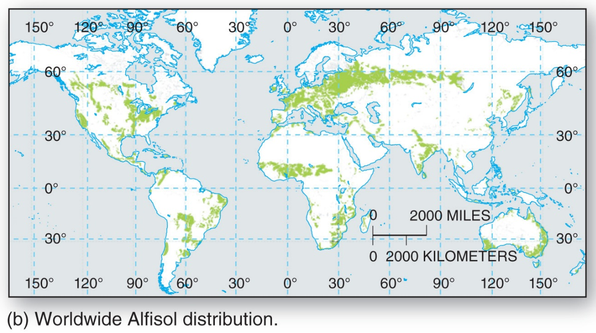

### Ultisol

- Highly weathered forest soil
    - Might form from alfisol if weathered more over time
- Wetter, warmer climates
- Reddish like oxisol (residual Fe and Al oxides)

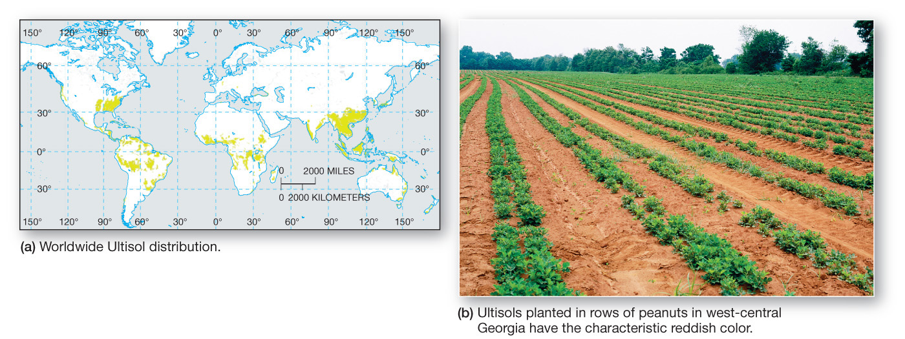

#### Ultisol vs oxisol

- **Horizon and clay uniformity:** Oxisols most weathered in taxonomy: deeply uniform and oxic through soil profile, little variation in clay content. Ultisols less extreme, have distinct abrupt layer of clay accumulation in B horizon formed from clay migration.
- **Weatherable minerals:** Oxisols have almost none, ultisols retain more weatherable components.
- **Nutrient retention (CEC):** Ultisols have higher CEC due to clay accumulation in B horizon
- **Landscape and climate distribution:** Oxisols restricted to stable warm & humid, intertropical or equatorial zones. Ultisols from hupid tropics/subtropics to warm temperate (e.g., SE USA) occupying older, sloping or stable ancient land surfaces.

### Aridisol

- Dominated by *salinisation*
- Desert soils; low precipitation, high ET rates
    - Because dry, allows organic carbon to oxidise, and prevents soluble elements from leaching away in groundwater
- Lack organic matter
- Pale light colour near surface

### Vertisol

- Shrink-swell clays
- Lack distinctive soil horizons due to physical mixing

### Gelisol

- Form in polar and subpolar environments
- Permafrost found within 2 m of surface
- Freeze-thaw cycles annually or daily (**cryoturbation**)
- Only A horizon on top of permafrost

### Andisol

- From volcanic parent material
    - Andesite: moderate-silica volcanic rock (between basalt and rhyolite)
- Weathering of glassy volcanic ash and cinder
- High CEC & fertility

### Entisol

- Only weak A horizon

### Inceptisol

- A horizon, with weak B horizon

## Geomorphic significance of soils

In addition to geomorphology affecting soil production and development, soils also influence geomporphic processes. Interpretation of historic landscapes and evaluation of rates of change or timing of geomorphic and/or geologic events.

- Palaeosol: soils formed on past landscape; ancient soils where soil development has ceased (buried, relict, exhumed)
- Soil catena: suite of soils from different positions in a landscape (*ecologically relevant, or commonly used*)
- Soil chronosequences: can develop **Profile Development Index** (total time elapsed during development of any given soil)
- Interpretation of landscapes: dating and interpretation of Quarternary landscapes (using all these bits of info)

# Hydrology & drainage basins

**2026-09-30**

- Rivers responsible for about 85% of sediment delivery to ocean basins
- Glaciers really good and efficient at sculpting Earth's surface
- YET, sun is primary driver (precipitation and evaporation) of hydrologic cycle and therefore geomorphic hydrology 
- **Residence time:** average time individual water molecule stays in a particular reservoir
- Global hydrologic cycle is closed system: no loss or gain of mass, only energy
- Characteristics of precipitation: duration, intensity, Recurrence Interval (RI)
    - RI: probability of an event of a given magnitude occurring based on average amount of time between events
    - $RI = (N + 1)/r$, N: no. of obs. (e..g, max 24-hr rainfall in a year), r: rank of given magnitude event (1 being highest) from these observations
    - $P = 1/RI$
    - Often difficult to have so many observations for a certain variable, and we want to extrapolate statistically

## Precipitation pathways

What happens to precipitation (rain, sleet, snow) when it falls over land?

- **Interception:** delay in the fall of precipitation toward Earth’s surface caused by vegetation or other ground cover
    - Percentage of precipitation that lands on vegetation and does not reach the ground
    - **Stem flow:** some of the intercepted water drains down the stem of the plants to the ground
- **Throughfall:** precipitation that makes it to the ground surface either directly or by dripping from plant leaves (does NOT include stem flow)

What happens to throughfall and stem flow?

- **Infiltration:** penetration of the water INTO (through) the soil surface 
    - Determined by steepness, vegetation, degree of saturation (of soil with water), porosity & permeability (surface structure, and soil type & rock type)
- **Percolation:** the movement of water WITHIN (downward through) the soil matrix by gravity
- **Runoff:** movement of water across the land surface, eventually flowing to the oceans
    - **Overland flow:** water that washes across the ground surface in a sheetlike flow; can cause erosion
        - Hortonian overland flow (infiltration excess): inflitration rate exceeded by precipitation rate
        - Saturation overland flow: soil is saturated with water
    - **Stream flow:** channelized surface water flow
    
What happens to groundwater?

- Impervious layer --> saturated/phreatic zone --> water table  --> unsaturated/vadose zone (may have (capillary fringe))
- Saturated zone: movement by gravity and energy differences between two points
- **Hydraulic head:** measure of total energy of water at a specific point
    - Potential head (elevation) & pressure head (hydrostatic)
- Porosity and permeability
- Flow rate depends on hydraulic gradient (slope) and hydraulic conductivity (permeability of surface)
- Movement occurs along locally perpendicular lines (steepest descent, rather than greatest hydraulic gradient)

What happens to surface water in stream flows?

- Stream flow can come from: precipitation, overland flow, interflow (bank seepage), baseflow (perennial rivers fed by groundwater), upstream reaches
- Losing stream vs gaining stream

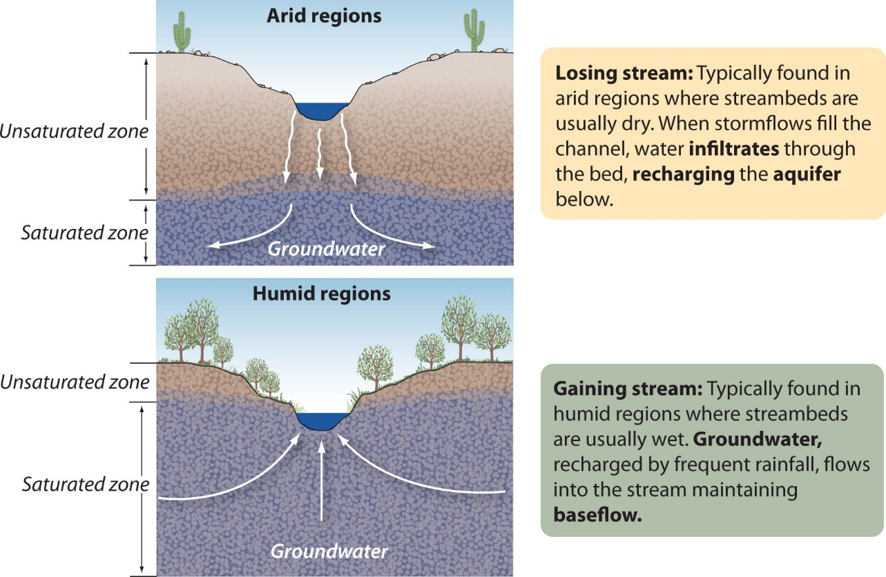

## Hydrograph

- Curve of discharge plotted over time
    - **Discharge:** volumetric flow rate $Q = width \times depth \times velocity$
- In US, water year/hydrologic year starts from October 1st (lot of rivers driven by snowfall regimes)

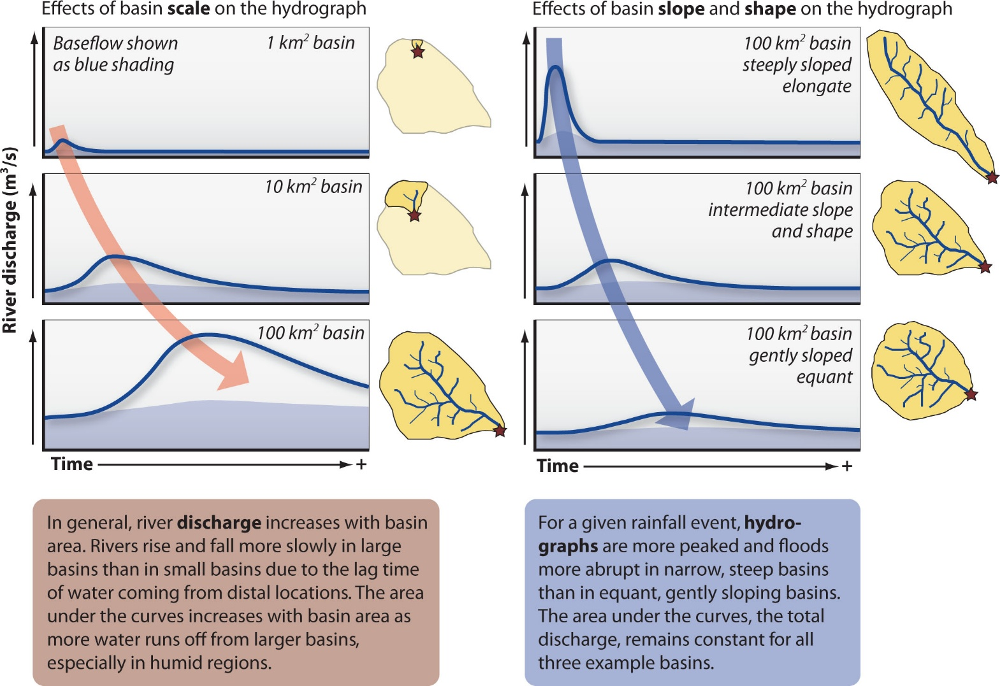

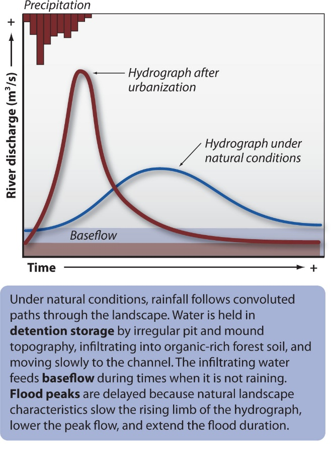

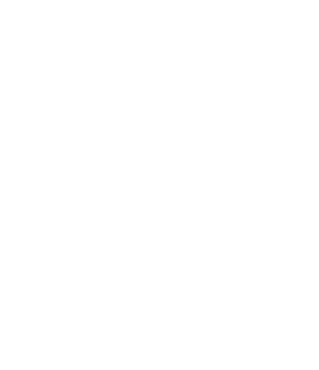

Hydrological data:

USGS – Real Time Water Data http://waterdata.usgs.gov/nwis/rt 
USACE – River Gages http://rivergages.mvr.usace.army.mil/WaterControl/new/layout.cfm 
NOAA – River predictions http://www.weather.gov/ 

## Flood/flow frequency analysis

- Annual series: take only max/peak per year
- Partial duration series: all peak discharges above certain threshold discharge selected arbitrarily for the river

# Basin Morphometry

**2026-10-05**

- Fluvial systems move water and sediment from continents to oceans (**process-based domains**)
    - Collecting region: dominated by erosion
    - Transporting: region moving water and sediment along
    - Dispersing region: dominated by dispersion
- Get water from:
    - Surface runoff (overland flow, rills, gullies)
    - Groundwater (base flow)
    
## Drainage basins, watersheds, catchments

- Area of Earth's surface that contributes water, sediment, and dissolved materials to a specific river or river network
- Downstream extent (single location) is selected to fulfull needs of analysis
- Bounded by **drainage divides**: topographical boundaries separating runoff and groundwater
    - Separates one basin from a neighbouring basin; ridges and highlands that mark the limits of the catchment area of the drainage basin
- Three terms mostly synonymous, though non-American use of "watershed" refers more to drainage divies (topographical highs separating basins), and catchments are usually smaller subparcels within the overall drainage basin (usually for large-scale systems like entire rivers)
- Delineating watersheds:
    - Determine area that contributes to single (defined) outlet location
    - Trace topographic high (divide) using elevation data
- Hierarchical arrangement: any drainage basin can be divided into several smaller drainage basins
    - Can define watershed for any point along any stream in a stream network
    - Most water authorities prefer maps at basin level rather than political/admin maps (e.g., below Louisiana river basins)
    
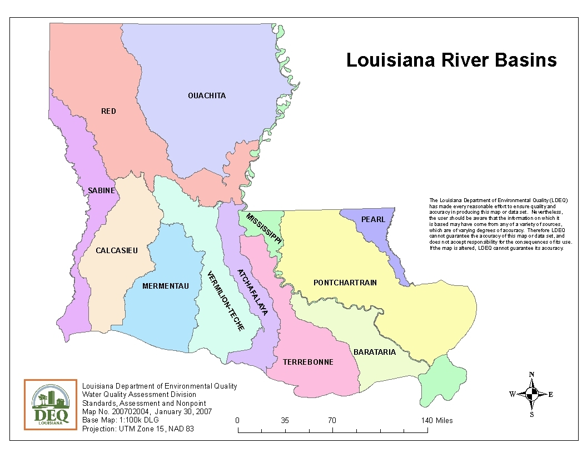

## Drainage patterns

- Largely controlled by underlying geologic structure
- Most common is dendritic, but others exist

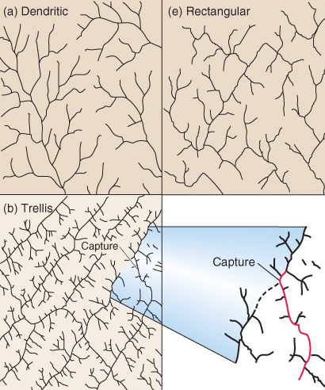{width="49%"} 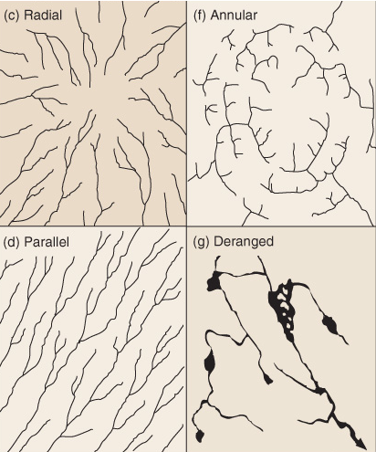{width="49%"}

- Dendritic: uniform rock composition and moderate slopes
- Trellis: dipping (monocline) or folded topography with differential weathering (kinda parallel to ridges)
- Radial: stream flows off a central peak
- Rectangular: faulted and jointed landscape direct stream courses in patterns of right-angled turns
- Annular: structural domes (formed by folding of rocks in 2d), with concentric patterns
- Deranged: chaotic arrangement of channels connecting small lakes and marshes, typical of landscapes following the retreat of ice sheets

## Morphometric indices

$$
\text{Drainage density} = \frac{\text{total length of all stream channels in basin}}{\text{area of basin}}
$$

- **Drainage density:**
    - Degree to which basin is dissected by stream flow
    - Affected by erodibility and permeability of rocks, steepness of slopes, and vegetation cover
    - Climate
        - Humidity encourages vegetation cover, reduces channel formation (holding surface sediment in place)
        - Arid: although vegetation cover is limited, there is not enough runoff to carve extensive channel systems
        - **Semiarid:** enough rain to produce runoff but not enough to sustain much vegetation
            - Badlands have high drainage density
- **Relief ratio:** ratio of total basin relief to basin length
    - $R_h =  \frac{\Delta H}{l_b}$
    - Indicates steepness of topography within basin
    - Insight into tectonic uplift and rock resistance, downslope pathways, storage time of water, sediment and solutes
- **Hypsometric curve:** proportion of total basin area on X and proportion of total basin height on Y, shows topographic variation/heterogeneity over the length of the basin
    - Area under the curve can be indication of watershed landscape evolution
- **Stream order:** hierarchical numbering system assigned to stream segments
    - Convenient means to indicate the relative size of a channel segment or of a drainage network
    - **Horton-Strahler approach:** 
        - Segment with no tributaries is first-order
        - Junction of two streams of order $u$ creates downstream channel segment of order $u + 1$
        - Junction of $u$ with order $<u$ remains as $u$
        - Drawback: violation of additive rule goes against physical system; properties like stream discharge can change when lower-order enters higher-order, but order of main stream remains unaltered (ignored size of basin)
    - **Shreve ordering system:**
        - Additive system; more popular in modern; shows magnitude
        - Network magnitude indicates number of exterior links upstream
        - Can then plot each split over "generations" of the basin on Y (**hydrograph**)
            - Diameter (max. link distance; no. of nodes between outlet and farthest first order tributary)
            - Generation (successive link distances from outlet to farthest first order tributary)
            - Width (no. of channels per generation)

## Delineating stream networks

**2026-10-07**

Above morphometric analyses require stream networks to be delineated, but how exactly do we do that?

How far upstream do channels extend? Difference between channel and hillslope hollow? Perennial vs ephemeral streams?

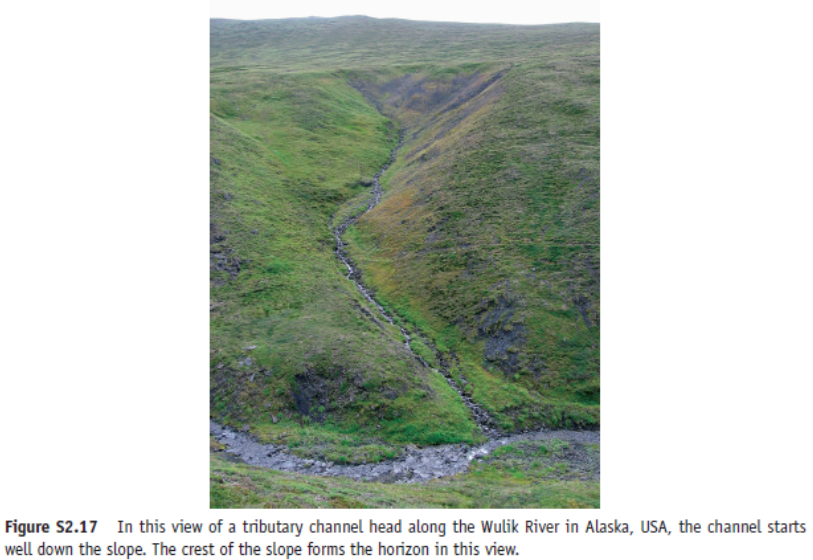

- **Channel initiation:** 
    - Channel head: upstream boundary of concentrated water flow and sediment transport, between definable banks, which separates process domains of hillslopes/unchanneled hollows from channel networks
    - Stream head: location where perennial flow occurs (downslope of channel head)
- **Channel maintenance:**
    - All stream channels require a *minimum drainage (contributing) area* in order to be maintained (regardless of how stream channelss are generated)
    - Some combination of slope and water
    - Flows in the initiated channel must be large enough and occur frequently enough to counteract infilling by mass movement, debris-laden flows, or rainsplash
    - **Hortonian overflow model:** as we go away from ridgeline, reach a point where depth/amount of water/slope high enough
        - Shear stress, $\tau = \rho g H S$ (density, gravitational acceleration, depth/height, slope)
        - From ridgeline: $\tau \lt \tau_c$ (no erosion) --> $\tau = \tau_c$ (critical value) --> $\tau \gt \tau_c$ (zone of erosion)
        - Further downstream, can return to $\tau \lt \tau_c$ (no erosion, but deposition)
- **Network evolution:** stages per Glock (1931)
    - Initiation --> extension by elongation (headward growth) --> extension by elaboration (tributaries) --> maximum extension --> abstraction/integration 

## Longitudinal profiles

Variation in slope of stream over its length. Generally, concave up, steeper at headwaters, gentler at mouth. WHY?

- **Base level:** theoretical level below which a stream cannot erode (denude) its valley
    - Barely enough slope (potential energy) to sustain water flow
- **Causes of profile concavity:** 
    - Discharge and sediment load/caliber both increase with length of river (lower gradient required to move load, all else being equal)
    - Grain size decreases downstream; combined effects of abrasion + selective sorting
- **Lane's balance:** degradation (scouring out of channel), aggradation (filling in of channel)
- **Graded stream:** mutual adjustment between slope, size and shape of channel for equilibrium; stream at equilibrium state between slope, size and shape of channel
- Local increases in gradient are called **knickpoints** (waterfalls, rapids); caused by layers of resistant rocks or faulting; over time with erosion, moves upstream (e.g., Niagara Falls)

- Morphological effects of dams: upstream deposition & downstream erosion

## Spatial differentiation of drainage basins

Schumm (1977): basins longitudinally zoned wrt sediment dynamics: headwater *production*, mid-basin *transfer*, downstream *depositional*

### Sediment connectivity and storage

- Headwater streams: sediment reservoirs at timescales of 10-100 years, episodically evacuated by debris flows and/or gully erosion
- Higher stream order and drainage area: sediment yield per unit area decreases and sediment residence time increases
- Coupled vs buffered links: 
    - How direct and fast sediment is transferred to channels from hillslopes
    - More buffered links (floodplains/valley-fill) at higher stream order

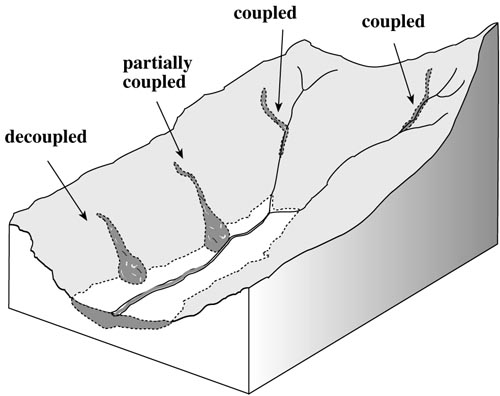

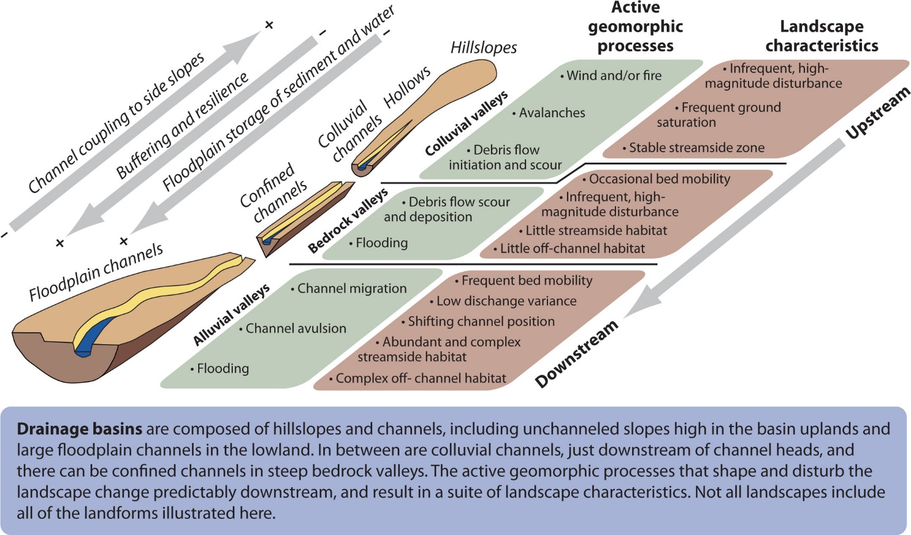

### Sediment yield and landscape denudation

- **Sediment yield:** total amount (mass) of sediment leaving a drainage basin per unit time (yr)
    - Accumulations of sediment in reservoirs/lakes, or sediment rating curves (load:discharge)
    - Most studies only consider suspended sediment since bedload data unavailable
    - Larger (higher order) watersheds have lower sediment yield
- **Denudation rate:** amount of sediment leaving basin; estimate of surface lowering (cm) per unit time (1000 yr)
    - Total sediment yield (volume) per unit area

# Fluvial Geomorphology

**2026-10-12**

Fluvial geomorphology is influenced by both internal and external factors. **External factors** include:

- Climate & hydrology (ephemeral/perennial)
- Tectonics & Geology
    - Resistance of underlying lithology
    - Sediment supply & caliber
    - Channel slope
    - Availability of storage
    - Alluvial/bedrock
    - Channel migration
- Vegetation
    - Resistance to flow (in-channel vegetation and/or debris)
    - Reinforcement of bank material (riparian vegetation)

Internal factors can be described by the **river dynamics trinity:** Physical changes in river channels can be explained by mutual adjustments and interactions among moving water (**flow**), **sediment** (erosion, transport, deposition), and channel form (**morphology**). These only consider the geologic/hydrologic context though, and not ecological.

## Flow

River hydraulics: study of movement of water through river channels and balance of forces acting on that water.

Gravity (driving force) and friction (due to roughness of grains, bedforms and channel curvature; resisting force). 

$$
Discharge, Q = width \times depth \times velocity = W \times D \times U
$$

Velocity depends on slope and roughness. Manning equation:

$$
U = \frac{1}{n} R^{2/3} S^{1/2} 
$$

where R is hydraulic radius (area divided by wet perimeter), n is Manning roughness coefficient (can also be defined by other variables like grain size), S is slope.

Froude number quantifies variability of velocity across channel, determines how disturbances (e.g., surface waves) interact with moving water.

$$
Fr = \frac{U}{\sqrt{gH}}
$$

If $Fr < 1$ **subcritical** (tranquil flow; effects spread both upstream and downstream), and if $Fr > 1$ **supercritical** (rapid flow; only downstream)

**2026-10-14**

### Changes in flow/discharge

How do channels accommodate changes in discharge?

Hydraulic geometry: quantify change in the three flow variables (y axis) against change in discharge on x axis. 

- **At-a-station** hydraulic geometry:
    - Temporal variability
    - One cross-section at multiple points of time, e.g., flood, spring/fall, summer
    - At a given point in the channel, especially upstream, walls are steep so width doesn't change much 
    - Velocity changes most (deeper flow reduces bed roughness) then depth then width
- **Downstream** hydraulic geometry:
    - Spatial variability
    - Multiple cross-sections along channel at one point of time
    - Wall steepness changes (not steep downstream)
    - Width mostly accommodates change in flow, followed by depth, then very slightly velocity

**Hydraulic geometry relations:** relations between discharge and width, depth and velocity follow power law (they are power law functions of discharge), with remarkable convergence (across rivers of the world) on specific values for coefficients in power law. 

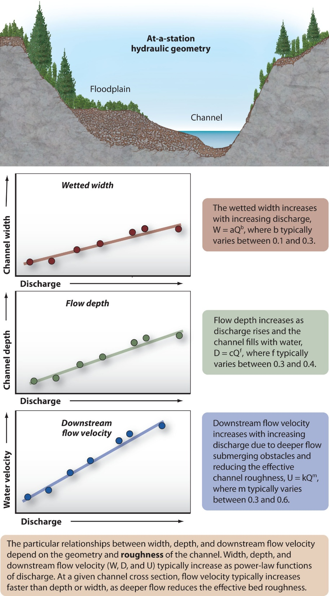{width="49%"} 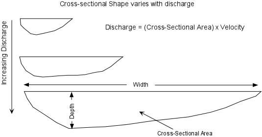

But in downstream geometry, need to be comparing the "same" *kind* of flow (not flow level, since change in that is what is of interest; but kind, see below) at the different points. What is this flow?

### Channel-formative flow

- **Dominant discharge:** Single event that represents entire range of morphologically significant flows
    - Conceptual value
    - Single event that determines the morphological characteristics of the channel, more than any other flow
    - All flows affect the channel but net result same as if this single event occurred continuously
    - Implies an event that represents equilibrium between process and form
- **Bankfull discharge:** stage just before flow begins to overtop the banks
    - Geometric value
    - Assumptions: defined only for self-formed depositional processes (not valid for erosional/incisional channels); channel size relatively constant through time
    - Related to flood recurrence interval (most perennial streams have RI for bankfull discharge at 1--2 years)
- **Effective discharge:** discharge that does most geomorphic work (sediment transport; using magnitude-frequency analysis)
    - Geomorphic work: product of flow frequency and transport rate
    - Combination of discharge frequency histogram and non-linear sediment discharge rate (higher for infrequent high magnitude flooding events)
- Turns out that these 3 discharge concepts are roughly the same! (Based on RI comparisons)

## Sediment

**2026-10-16**

- Sediment supply:
    - Delivered from upstream sources:
        - In-channel reaches
        - Hillslopes
        - Bed and banks
    - **Transport Capacity:** max. amount of sediment that can be transported by given flow
        - If dam exists, stops sediment, and downstream has more erosion
    - Sediment caliber: size (competence) and sorting
- Hydraulics and stream transport: channel's ability to transport sediment increases with discharge
    - **Stream Power** $\Omega = \rho_w g Q S$ (rate of potential energy loss per unit channel length)
    - **Unit Stream Power** $\omega = \Omega / W = \tau U$ (per unit area of channel bed)
    - **Shear Stress** $\tau = \rho_w g H sin\theta = \rho_w g H S$ ($sin\theta$ approximates to $tan\theta$ at low slopes)
- Load types
    - Dissolved/solution load: material dissolved in water (usually calcite or salts)
    - Suspended/wash load: fine-grained clasts suspended in water, held up by turbulence (usually clays, silts)
    - Bed load: coarser materials moving along channel bed
        - Traction: rolling, sliding (constant contact)
        - Saltation: moving along in short hops, bouncing

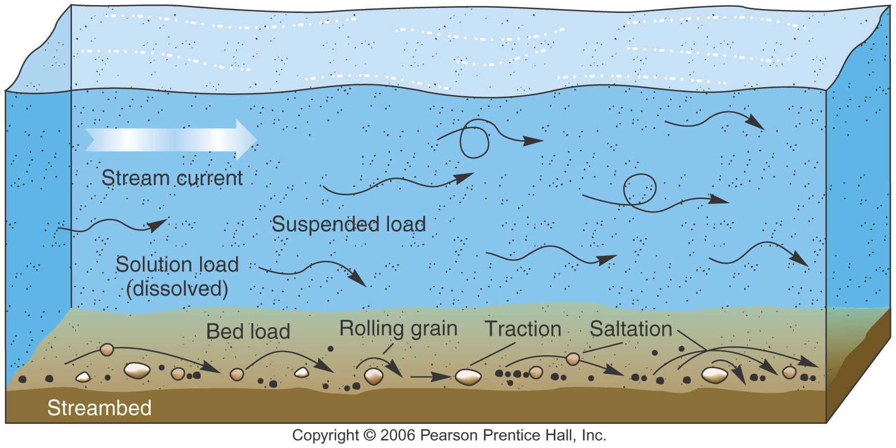

**Hjulström diagram:**

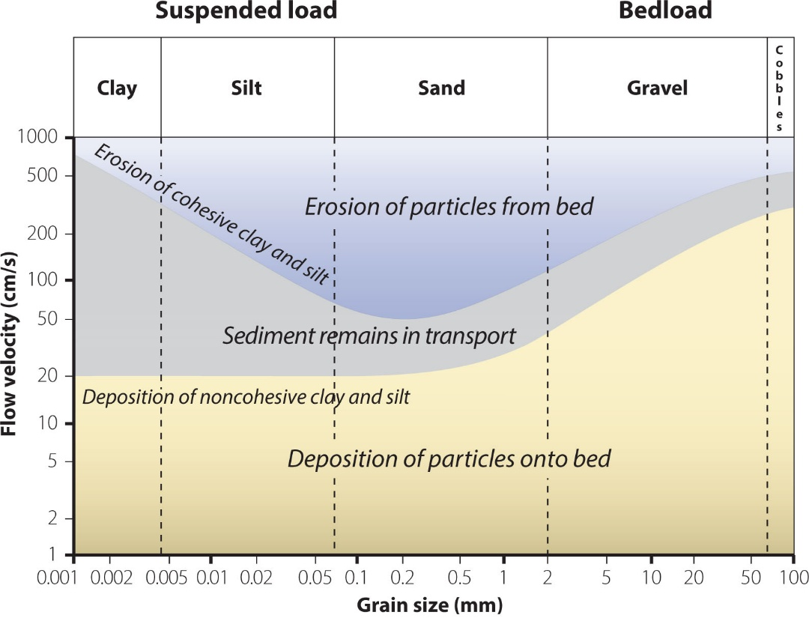

- Velocity vs grain size; what velocity for erosion, transport, deposition
- Erosion: 
    - For very small (clay-like) particles, required velocity for initial movement is high because they are cohesive and occur in clumps
    - But after some mid-point of grain size (sand), it becomes linear increase (intuitive)
- Transport:
    - For gravel, very narrow range of velocity for transport, because it very quickly starts settling down to bed (deposition)
    - Clay and silt require very little velocity once eroded to stay in transport
    
### Bedforms

- Arrangement of sediment as waves that get moved along the bed
- Bedform types: Ripples (smallest scale, <3cm height, so small grain size), dunes (larger, 10cm to multiple m), bars (largest scale)
    - Cross-bedding: preservation of angle of trough slope of dunes through dune migration
    - In unidirectional flows (rivers) ripples/dunes are asymmetric 
- Larger the bedform, more resistance there is to flow; because $Q = W H U$, larger discharges result in larger bedforms (higher H, lower U); above certain threshold flow, bedforms flatten out (restore U)
- **Barforms:** Larger than bedforms
    - Longitudinal, lateral, transverse
    - Point bar (+ cutbank)

<iframe width="560" height="315" src="https://www.youtube.com/embed/KYvWwbEi0A0?si=zty0sy7yBsDZawF2" title="YouTube video player" frameborder="0" allow="accelerometer; autoplay; clipboard-write; encrypted-media; gyroscope; picture-in-picture; web-share" referrerpolicy="strict-origin-when-cross-origin" allowfullscreen></iframe>

## Morphology

**2026-10-19**

### Channel planform

- **Channel planform:** pattern of river as viewed from above
- Distinguished based on **sinuosity** and **single/multithread** channel
    - Sinuosity: how much channel planform deviates from straight path (length along channel divided by straight line length)
- Types: straight, meandering, braided, anastomosing
- Depends on slope and sediment load

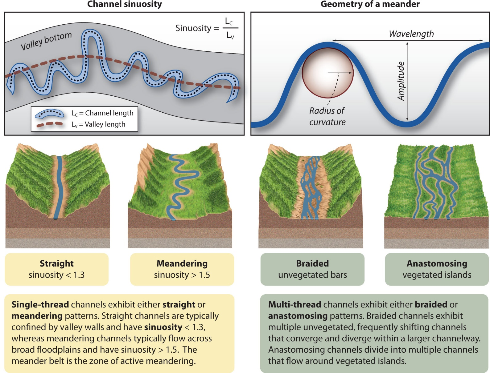

#### Meandering

- Curving channel boundaries results in curving path of highest velocities (fastest on outer bank, slowest on inner banks)
- This leads to:
    - Erosion along outer bank (pool & cut bank)
    - Deposition along inner bank (point bar)
- Meander migration
    - View on GEE any river [here](https://earthengine.google.com/timelapse/)
    - Over time, meander bends may intersect to form **cutoffs**, which later turn into **oxbox lakes** (eventually deposited/filled in, to form meander ?stars?)
    - Neck vs chute cutoffs (distance less than one channel width, vs overbanking/flooding)

#### Braided

- Multiple interconnected channels separated by unvegetated bars
- In bankfull discharge, all connected into one channel, so don't name individual channels
- Channels/bars always changing over time
- Common in arid & glacial
    - Variable discharge (more like polarised levels)
    - Steep slopes
    - Abundant bed load
    - Erodible/non-cohesive banks

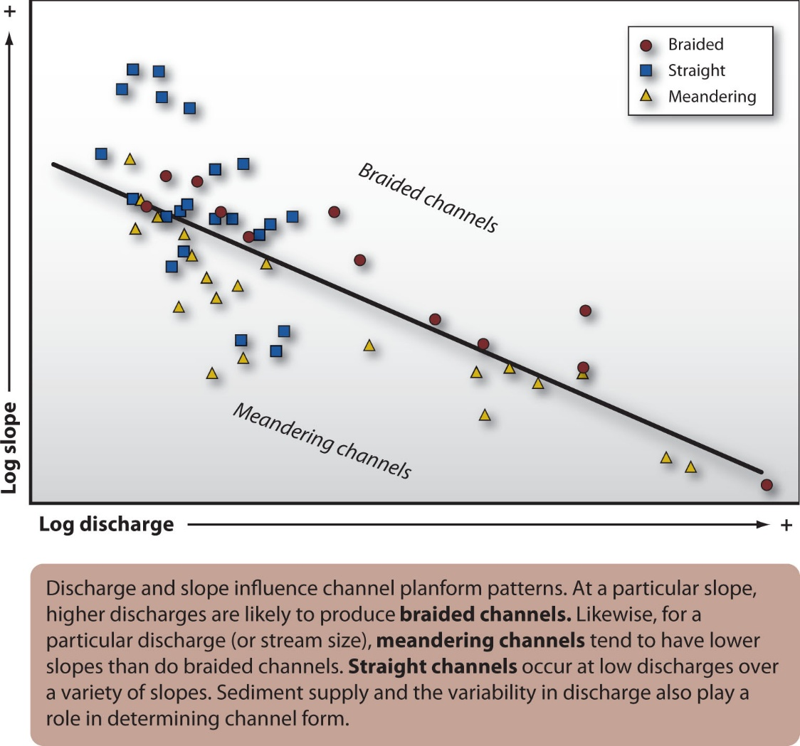

#### Anastomosing/anabranching

- Multiple interconnected channels separated by vegetated floodplain (islands)
- Generally very large river systems
- **Anabranching:** more general term, can span wide range of stream energies and gradients
- **Anastomosing:** specifically low-energy, low-gradient systems with low channel migration rates, characterised by fine-grained, cohesive, organic-rich sediments (downstream, transportation/dispersion processes)

### Channel-reach morphology

Smaller scale than 4 types of rivers

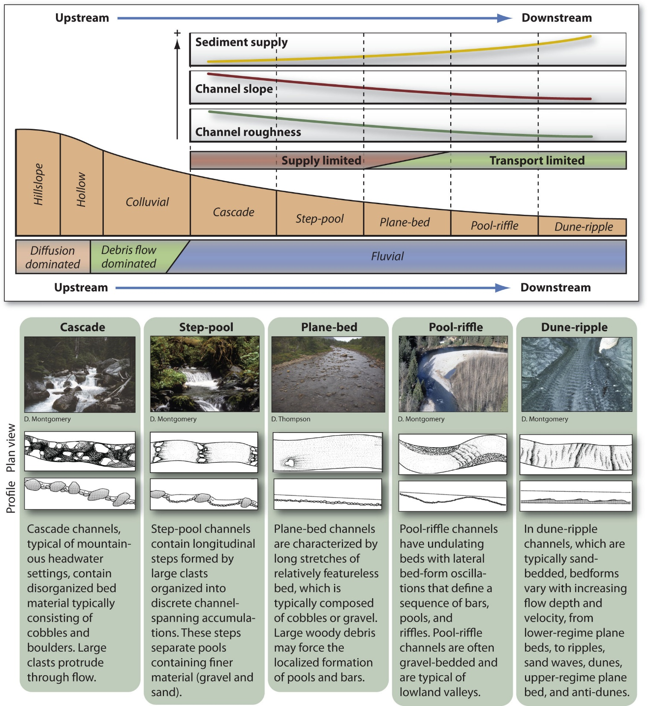

## Fluvial landforms

### Valleys

- Valleys fundamental features of fluvial erosion
- Generally V-shaped (unlike U-shaped of glaciers)
- Eventually lose downcutting ability, then start valley widening 

### Terraces

- **Alluvial terraces:** form when change in env. conditions isolates floodplain from river channel
    - Level areas of river sediment (alluvium) stepping down toward river channel
    - Caused by river degradation (incising) due to episodic drops in base level relative to river bed (caused by uplift or drop in sea level or local base level)
    - [Video](https://mediaplayer.pearsoncmg.com/assets/hi0j429j5LerlRsY5pJNfNsRG0hKGEPa)
- Strath terraces: flat bedrock instead of alluvium

### Floodplains

Most rivers around the world reach bankfull/dominant discharge every 1--3 years, so floodplains very much active part of river system. They are the storage area for water during floods, and for sediment over decades/centuries. They are formed by:

- **Lateral accretion:** sediment on point bars as river migrates across valley bottom
- **Vertical accretion:** 
    - **Overbank deposition:**
        - Deposition of fine sediment that falls out of suspension during floods, because flow slows as soon as leaves channel
        - Natural levees form: alluvium deposits directly over channel banks, forms ridge following channel banklines
        - Self-limiting process
        - Yazoo channel: 
            - In large floodplains and deltas
            - Water coming down from valley walls can no longer connect to main channel
            - End up forming tiny channels off to the side
            - Themselves may show all the same fluvial properties/patterns: not always neat linear channels
            - Named after actual Yazoo River (NE corner of LA, border with MS)
        - Man-made levees: higher levees usually become problematic downstream, since they increase the velocity and depth of the flow, meaning flood events hit that much harder
        - Setback levee (engineered): 
            - Placed farther away from natural banks, expands channel capacity
            - Allows for flooding corridor: designated, controlled path where the river can naturally spill over into its floodplain
            - The norm in places like Netherlands, but in the US levees have mostly been built right at the river's edge
    - **Avulsion:**
        - Non-meandering channel with frequent floods: entire channel rises up due to deposition, eventually causing an abrupt switch in the main river stem
        - (Like desire paths, seeks the steeper path from A to B lateral to the original stem)
        - Repeat: starts building up there, then another switch
        - Switch often caused by sediment impoundments behind log jams
        - Non-meandering: not much lateral movement, so starts forming web-like channel structure
    
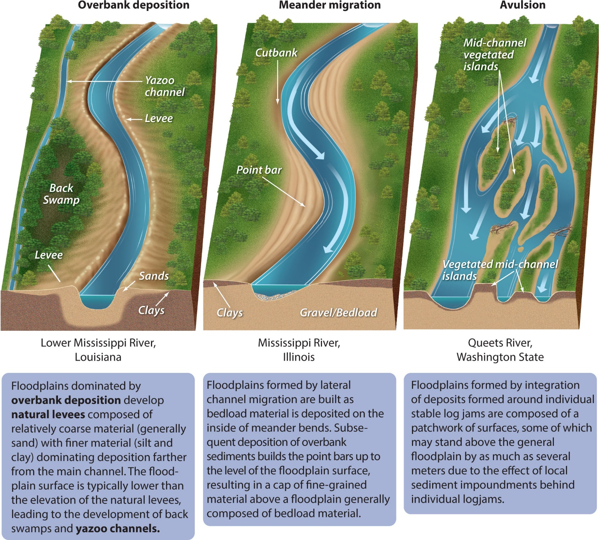

::: {.callout-tip title="Alluvium and regolith"}
Broadly speaking, there is no distinction between material produced from weathering in one place, versus material that settles somewhere after transportation post-erosion. So, alluvium deposits that settle somewhere are technically a part of the regolith there. However, regolith is sometimes further grouped into ex-situ and in-situ based on the provenance of the material. 

How to ascertain provenance? Commonly using isotope analysis, but none of the usual ecological ones: carbon doesn't tell too much, but uranium (vertical age stratification using decay times) and caesium (more about *where from*) are useful. Another common method is analysing zircon, a mineral highly resistant to erosion, which can tell you where the alluvium came from and how old it is.
:::

# Hillslopes and mass wasting

**Missed class on 26 Oct (entry seminar)**

- Erosion: denudation by flowing water, wind or ice, which dislodges, dissolves or removes surface material
- Transport: actual movement of weathered and eroded materials by transporting agent like water, wind or ice
- Mass movement: any movement of material under influence of gravity, with little or no transporting agent (collective term, all gravitational downslope movement of rock, weathered rock debris, or soil)

Fluvial vs hillslopes, alluvial vs colluvial
        
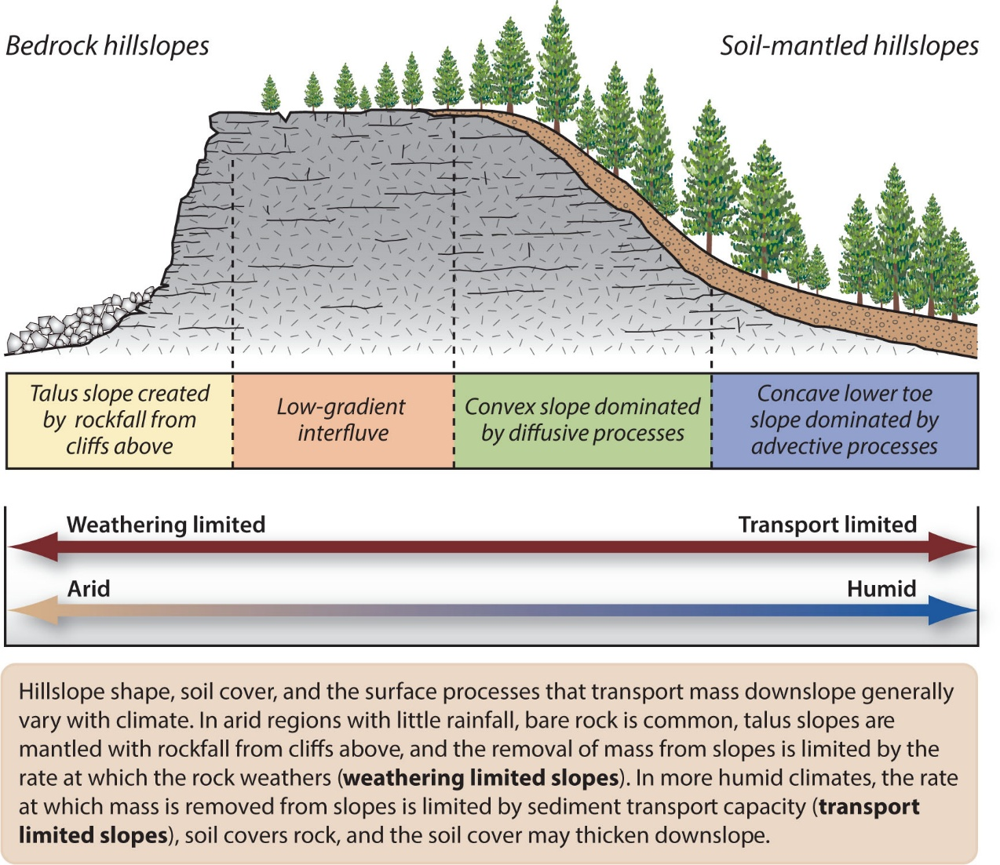

## Hillslopes

- Diffusive processes
- Usually imperceptible changes
- Downslope transport rate proportional to local gradient
- **Rainsplash:** impact from raindrops dislodges soil and sediment on surface (important in sparsely vegetated terrains)
- **Sheetwash:** shallow, non-concentrated overland flow, more effective in sparsely vegetated terrain (vegetation slows overland flow and increases infiltration rates)
- **Creep:** Incremental downslope movement of soil and sediment (extremely slow, mm/yr); continuous (clays) vs seasonal (frost heaving)
- 

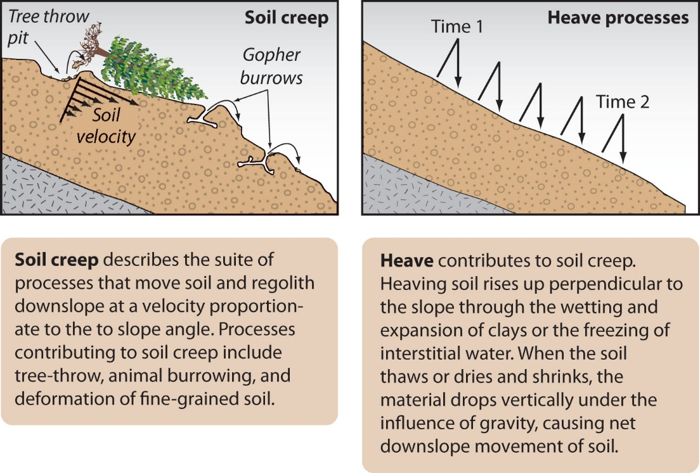

**2026-10-28**

## Mass wasting

- Synonymous with mass movement
- Gravity-driven events moving colluvial material downslope
- **Colluvium:** unsorted, mobile hillslope material that overlies a more stable substrate
- Perceptible changes (e.g., natural hazards)
- Water usually plays important role, but not as transporting agent (as in rivers and glaciers)
- Balance between shear stress and shear strength (which is affected by water content)

### Examples

- Earthflow ([video](http://www.youtube.com/watch?v=R__3DYQCVnA))
- Coarser material, faster pace ([video](http://www.rts.ch/video/info/journal-continu/4913479-effondrement-d-une-falaise-a-riddes-vs.html))
- Avalanche ([video](https://www.youtube.com/watch?v=82JOJ3Yq3KA))
    - Characteristic is not necessarily snow/ice, but entraining of air within (billowing form)
    - Rock avalanche ([video](https://www.youtube.com/watch?v=SK38UDPhQEk))
- Debris flow, also coarser material (boulders) riding on top of finer material ([video](https://www.youtube.com/watch?v=8mKC3eID074))
    - Sometimes water caught within it, but that's not causing transport ([video](https://www.youtube.com/watch?v=MDcze8yaa64))
    - Size of boulders and how they move ([video](https://www.youtube.com/watch?v=Fsh5E9m3PrM)) (fluvial vs colluvial process)
- Nepal ([video](https://www.youtube.com/watch?v=oVrKzYP476s))

### Forces involved

Earthquakes, heavy rainfall (adds buoyancy), etc. are what change the balance of driving and resisting forces. The resisting forces (like friction) typically have a maximum value.

**Shear strength:** function of three components: (1) angle of internal friction (2) normal stress (3) cohesion

- **Angle of repose:** maximum angle that grains can create when stacked (e.g., sand dumped in conical form)
- **Angle of internal friction:** related to degree of interlocking between particles and the surface roughness of the material
    - Approximated by angle of repose
    - Higher angle for coarser sand, and for angular pebbles
- Normal stress
    - Component of gravitational force that is perpendicular to slope; decreases as slope increases
    - Contributes to friction between material and slope, which tends to hold material in place
- Cohesion
    - Stickiness of particles to each other
    - Related to electrochemical attraction between soil particles
    - Strongest in fine clays
    
**Effective shear strength:** Coulomb equation

$$
SS = C + \sigma' tan(\psi)
$$

Cohesion, effective normal stress (accounting for buoyancy), angle of internal friction

**Slope stability:** Factor of Safety Ratio (F)

$$
F = \frac{Shear\ Strength}{Shear\ Stress}
$$

If F < 1, unstable, prone to mass movement. If F > 1, stable, not prone to mass movement. If F = 1, threshold, may or may not move. Generally, F around 1.5 could be prone to failure, while 2--3 less susceptible. 

### Role of water

Little bit increases friction due to surface tension (cohesion?), but too much reduces friction because particles no longer touching. 

**Pore water pressure:** When water is saturated within pore spaces (phreatic zone), hydrostatic pressure is a good estimate of pore water pressure. In unsaturated zone (vadose zone), water held by capillary stresses can result in negative pore water pressure, increase slope stability. Also important process in river bank failures. 

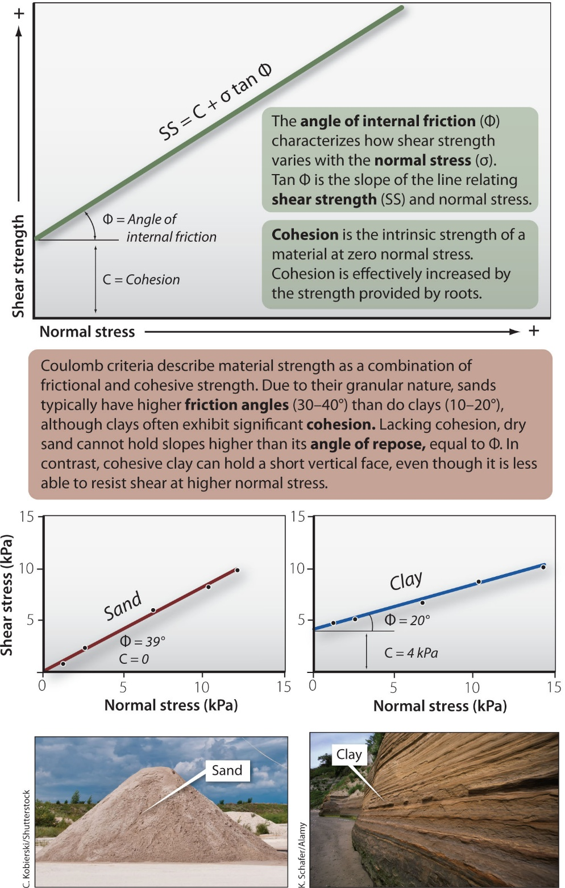

- Quantifying cohesion
    - Direct Shear Box
    - Apply different normal stresses to sample, then apply shear stress until failure
    - Linear regression: cohesion = y intercept, internal friction angle = slope
- Slope Stability Analysis
    - Infinite slope (single block on slope)
    - Method of slices (vertical slices, add up individual properties and values)

### Role of vegetation

- Adds to resisting force (shear strength)
    - Interception of rainfall
    - Uptake of ground water by roots
    - Root reinforcement (anchor)
    - Soil development (cohesion)
- In practice, lump the effects into cohesion; express vegetation as an apparent cohesion
    - Measure/model tensile strength of roots to hold slope material
        - Device called root puller

## Classifying mass movements

- Processes driving these are continuously varying, but we're trying to fit nice distinct rigid boundaries, so imperfect system but useful
- Broadly based on type of material and type of movement (Varnes 1978)
- 

**2026-10-30**

### Slide: translational (planar)

- Sudden, rapid movement of material along flat failure place that is parallel to ground surface
- Block moves with little to no internal disruption

### Slide: rotational (slump)

- Rotational failure of material along concave upward failure surface
- Common in thick cohesive soils
- Some internal disruption

### Fall: rockfall

- Fast and dry
- Falling pieces of rock downslope
- Forms "talus" slope (pile of rock pieces at angle of repose)
- Common in mountainous areas and areas with freeze-thaw weathering

Video [1](http://www.youtube.com/watch?v=QdsxtCtX5nk) and [2](https://www.youtube.com/watch?v=qcrRf8wY8YE)

### Flows

- Solifluction (slow and wet): Slow flow of soil saturated with water, forms lobes; related to freeze-thaw
- Earth flow (slowest flow, lower moisture content)
    - [Italy](http://youtu.be/E5FF3vIEIqg)
- Debris flow (fast, lower moisture content)
    - Coarser debris usually in front (snout), top layer; debris becomes finer farther from snout
    - Brazil Nut effect (coarser particle rises up in container with disturbances)
    - [Afghanistan](https://youtu.be/51C7vEAVbxk?si=BVjXb9OOuy-3h63c)
- Mud flow (fast, highest moisture content)

Supersaturation of material with water leads to thick paste or ooze moving downslope. But water is not the transporting agent, does not itself exert shear stress on the material. Water simply reduces shear strength of the material. 

## Slope morphology

One way to understand how prone landscape is to mass wasting events, important for planning. 

Convex slopes usually not prone to mass wasting, they simply diverge/push material into concave hollows/slopes. 

[Debris flow barriers](https://www.youtube.com/watch?v=ODE1OtTwCfI)

# Aeolian Geomorphology

**2026-11-04**

- Aeolus, Greek god of wind
- Processes of erosion, transportation and deposition by wind, and the resulting landforms
- Wind moves air that is generated by pressure differences in atmosphere
    - Higher pressure gradients = high wind velocity
- Topography can also influence winds: orographic lift (vertical), horizontal confinement
- Trees, buildings, rocks, etc. provide roughness and form drag, increases turbulence locally, results in dissipation of kinetic energy and overall reduction in wind velocity

- Velocity of wind determines largest grain size that can be moved
    - To move 1mm sand grain, wind speed required 45 cm/s, water speed 20 cm/s (due to buoyancy, lower viscosity)
    - Water is more viscous than air, so settling velocity is slower than in air
- Loess: typically silt (fine-grained), sediment that gets lifted then settles and blankets landscapes

- Aeolian process important in:
    - Deserts (dry with little vegetation cover)
    - Where sediment supply overwhelms vegetative stabilisation (sandy coasts, intensively cultivated land, glacial outwash plains)
- [Self-organisation of sand in ripples and dunes](https://www.pbs.org/video/sand-dunes-shouldnt-exist-heres-why-they-do-bkmh9e/)
    - Ripples are result of sand-sand interaction
    - Dunes are result of sand-wind interaction
- Most sand moves by saltation, very fine occasionally by suspension, and coarse sand moves along the ground my surface creep (traction)
    - Once suspended, can travel for very long distances ([Saharan Dust to Amazon rainforest](https://www.voanews.com/a/study-saharan-desert-dust-feeds-amazon-rainforest/2676025.html))

## Aeolian erosion

- **Deflation:** removal of fine-grained components of top layer of sediment, leaving behind a coarse surface, called **deflation/desert pavement**
- **Abrasion:** wind carrying saltating sand can effectively sandblast rock surfaces
    - Limited to 1-2m above ground
    - **Ventifacts:** rock shaped by wind abrasion, creating angular shape or narrow neck close to ground
    - **Yardangs:** wind-sculpted streamlined/elongated hills (m to km in scale), indicate dominant wind direction
        - Larger in scale than ventifacts
- **Hamadas:** deflation + abrasion
    - Desert rock surfaces or plateaus with little or no sand
    - More typical of deserts than popular "sand seas"
- Dust/sand storms: hugely erosional (abrason + deflation)
    - [Australia video](https://www.youtube.com/watch?v=95tmYmeHf84)

## Aeolian deposition

- **Loess:** silt sediment when transported by wind
    - Widespread wind-blown deposits mainly of silt, blankets landscape
    - Tunica Hills, LA & Natchez, MS

- **Ripples:** small asymmetric ridges related to length scale of saltation
- **Dunes:** asymmetric hills of sand, bigger than ripples, tend to migrate downwind unless stabilised with vegetation
    - **Barchan:** crescent-shaped, wind toward horns
        - Relatively short horns, apex is wide
        - Limited sand supply
        - Unidirectional wind
        - Little-no vegetation
        - Resistant substrate
        - Migrate (move)
    - **Parabolic:** crescent-shaped, wind toward concave side
        - Long horns/arms, narrow apex
        - Do not migrate, arms anchored by vegetation
        - Erodible substrate (U-shaped "blowout")
        - Common on coastlines
    - **Transverse:** dune crest (linear ridge) perpendicular to wind direction
        - Abundant sand-supply (coalescence of barchans)
        - Unidirectional winds
        - May or may not be anchored by vegetation
        - If ridge less linear, more wavy, considered barchanoid
    - **Longitudinal:** linear ridges oriented parallel to wind direction
    - **Star:** multiple arms from multidirectional winds
    

- **Ergs:** ?

# Coastal Geomorphology

**2026-11-06**

- Coastal morphology largely controlled by tectonic setting
- Sea-level change also controls base level and potential for landscape denudation
- Other factors:
    - River inputs (freshwater & sediment)
        - ? Estuary: river without much sediment, just valley with water mixing ?
    - Tidal range
    - Wave action
- Active continental margins
    - Along continental plate margin that is convergent or transform with an oceanic plate (different plates along boundary)
    - Commonly have tectonic activity (earthquakes, volcanoes, mountain building)
    - Continental shelf generally narrow or does not exist (water depth rapidly increases away from coast)
    - Sites of active erosion and weathering!
    - West coast of USA
- Passive continental margins
    - Along continental plate margin not experiencing active tectonic forces (divergent)
    - Deposition of large amounts of sediment (without tectonic forces)
    - Wider continental shelf, low relief, shallow water
    - Gulf and Atlantic coasts (divergence from Pangaea)

## Influence of sea level

- Actual sea level change (**eustatic**)
    - Amount of water storeda s glavial ice
    - Temperature and salinity changing volume of water
- Lifting or sinking of land surface (**isostatic**)
    - Continental plate itself rising or falling
    - Or, along coasts with sediment deposition, land subsides down
- Shifting coastlines (without isostasy)
    - Emergent: stretches of coast exposed by relative sea level fall
    - Submergent: stretches inundated by water due to relative sea level rise
    - Regression: increased glacial ice, cooling and contracting of water
        - Coastlines migrate seaward (emergent), fluvial systems extend to reach the sea
    - Transgression: melting glaciers, warming waters
        - Coastlines migrate landward (submergent), fluvial systems drown
- Balance between eustatic sea level change and sediment supply
    - If SL rise = sediment supply, relative same coastline
    - If SL rise > sediment supply, submergent
    - If SL rise < sediment supply, emergent
    - But depends on where sediment supply occurs; can maintain coast at mouth, but submerge away from mouth
- **Continental shelf:** part of continent submerged in relatively shallow sea (100-200m deep), very flat, ends at a point of increased slope
- **Continental slope:** steeper thans helf, transition zone between continental crust and oceanic crust
    - Also driven by history (e.g., glacial periods)

## Coastal processes

- Wave regime (high or low energy, protected area or not)
- Tides (tidal range, relative strength of tides & waves)
- Rock resistance
- Climate
- Human impacts
- Atmospheric winds

### Waves

- Friction between wind over ocean water and water
- Drag on water, causes undulations of water surface (waves)
- Origin: zone of strong winds associated with storms at sea, radiate outward in all directions
- Wavelength, wave height (amplitude), period
- Waves are mechanism of energy transfer
    - Only small amount of water actually moves in direction of wave, but wave energy travels
    - Wave energy: kinetic energy of orbital motion of water particles as wave passes by
    - Separate from oceanic currents that actually do move water
    - [Orbital motion of wave energy](https://www.youtube.com/watch?v=7yPTa8qi5X8)
    - Wave base: distance below surface where no more wave energy felt (usually 1/2 of wavelength)
- **Deep water:** when wave base above sea floor
    - As waves move away from source zone in the Deep Ocean they spread out into smooth, rounded forms called swells
- Shallow water:
    - Water depth < wave base
    - Friction between ocean floor affects orbital motion: wavelength becomes shorter, waves, start to bunch up, wave height increases
    - Top part of wave moving faster than bottom
    - Eventually over-steepends and **breaks**
    - Spilling, plunging, surging breakers
- Coastlines have uneven water depth, so certain parts of wave slow down faster than others, causes **wave bending (refraction)** to strike coast at subparallel angle
    - Causes concentrated wave energy in headlands (erosion), and diffuse wave energy in coves/bays (deposition)
    - Tends to straighten coastlines over time

- Extreme waves
    - **Storm surges:* large frontal storms, tropical storms or hurricanes *push* water inland because of strong winds (e.g., Hurricane Sandy)
    - **Tsunami:** earthquake-generated displacement waves
        - Wave motion reaches all the way to ocean floor even in deep water
        - Really long wavelength, travel fast
        - As approaches shore, shortens and increases in height
        - Advances as massive wall of water far onto land
        - Can produce dramatic change in coastal landscapes, especially eroding coast during outflow
        - Can have multiple waves arriving many minutes apart (20-60 min)
        - [Japan](https://www.youtube.com/watch?v=B01vktb2bj4&list=PL8A0FE8E47C9FCA90&index=3)
        - [Landslide-caused](https://www.youtube.com/watch?v=_RMprH-4QC4&list=PLFF513AD10F64B864&index=3)

## Coastal landforms

### Erosional coasts

- Do not have to be active plate margins
- Drop in relative sea level
- Strong wave energy
- High relief
- Dominant feature: cliff
    - Sea undercuts the cliff (wave-cut notching)
    - Rockfall, landslides
    - **Wave-cut platform:** flat surface standing slightly below water surface at high tide (as cliff retreats)
    - Erosional remnants of cliffs: sea stacks, arches
    - **Marine terrace:** wave-cut platforms uplifted above level of wave action (tectonic uplift of coast or drop in sea level)
- Tide pools
    - Form in irregularities on wave-cut platforms
    - Protected from large predators
    - Mini-ecosystems that can cope with daily fluctuations in temperature, salinity, oxygen
- Even though deposition does exist, form of coarse gravel

### Depositional coasts

- Generally passive margins
- High sediment input
- Low wave energy
- Gentle relief out to coast
- Dominant feature: beach
    - Defined as location along coast where sediment is in motion
    - Beach ridge: ridge on landward side; zone of coastal dunes, often vegetated
    - Berm: horizontal surface formed by deposition of sediment during backwash; produced by deposition on beach face; only inundated during storm surges
    - Beach face: sloping surface partially submerged during high tide; swash zone
    - Longshore bars: result of sediment transported offshore from beach face and berm 
    

- Beach drift:
    - When waves are not parallel to the shore, water swashes up the beach face at an angle, then backwashes straight back down the slope of the beach face 
    - **Beach/longshore drift** is the movement of beach sediment along the shoreline by swash and backwash
- Spits: extended stretch of narrow beach formed
- Tombolo: spit that connects mainland to an island
- Lagoon: calm water in a bay sealed from the open sea by a spit that connects two sides of the bay (bay barrier)
- Barrier Islands: linear islands separated from coast by a lagoon (salt marsh)
    - Growth and separation of a spit
    - Bar submergence of old beach ridge or topographic high
    - Bar emergence or growth of offshore bar following strong storm
    - (During last glacial period: Sea level ~120 m lower, ~60 – 150 km seaward)
 
 
 
 Man-made depositional features (structures to prevent longshore drift):
 
 - Groin: rock walls perpendicular to coast that trap longshore drift sediment
    - Results in erosion on downcurrent side of groin (because sediment blocked)
    - So have to place a series
- Jetties: parallel walls connecting backwater to open water; force water to move through to maintain current
- Deltas: fan-shaped deposit of sediment where a river flows into a body of water (ocean, lake)
    - Reduction of flow velocity results in deposition
    - Characterized by distributaries
    - Shape determined by dominant energy regime:
        - Sediment input/river dominated: bird-foot--shaped (Mississippi)
        - Wave-dominated
        - Tide-dominated

- **Delta avulsion/lobe-switching:** rapid relocation of main stem channel of delta to begin depositing in new area
    - Node: upstream location where avulsions tend to occur; backwater length scale
    - Atchafalaya River represents a "preferred" pathway for water/sediment delivery to coast (shorter length, higher energy gradient); so avulsion node is around Old River Control Structure (here, bed depth same as sea level; so in low discharge, saltwater comes in)

# Glacial & Periglacial Geomorphology

**2026-11-13**

- Glacier: body of moving ice formed on land by compaction and recrystallisation of snow
    - Snow --> **firn** --> glacial ice (increases density)
- Two requirements:
    - Mass must be formed from accumulation and metamorphism of snow
    - Ice must be moving (pull of gravity), either internally or as a sliding block
- Very powerful at sculpting Earth's surface!
- Involved in Hydrologic and Rock Cycles (leads to sedimentary rocks)
- Most freshwater (ca. 77%) on Earth frozen in glaciers
- Today, glaciers + ice sheets cover about 10% Earth's land surface

- In Antarctica, need about 80m accumulated snow to get glacial ice below
- In Alaska (away from poles), roughly 13m
- Where? High latitude or high elevation
- How much time?
    - Antarctica desert (< 8cm precipitation annually), so may take 1000 years
    - Temperate climates have more precipitation, so just several years

## Types of glaciers

- Classification methods:
    - Morphologic: cirque, valley, ice sheets; mountain ice sheets, piedmont glaciers
    - Thermal: where form (temperate, polar)
    - Dynamic (movement): active, passive, dead
- Two general groups of glaciers (for further classification)
    - Alpine glaciers
        - In mountain ranges (mountain glacier)
        - Cirque: in bowl-shaped depressions at head of valley
        - Valley: confined within valley originated by fluvial activity
        - Piedmont: towards end of valley, more lateral spread-out formation
        - *Restricted to the mountain-valley systems*
    - Continental glaciers
        - Very large, not constrained by valley walls
        - Extensive, continuous mass of ice; massive thickness (over a mile)
        - Extant continental ice sheets: Greenland, Antarctica
    - Ice cap & ice field
        - Area < 50000 sq. km
        - Interconnected valley glaciers
        - Caps: completely covered, no peaks
        - Fields: highest peaks stick out of ice
        - Iceland, Alaska, Canada, Scandinavia

## Glacier processes

- Glacial Mass Balance: open systems; inputs (snow, rock), outputs (ice, meltwater, sediment)
- More inputs --> glacial advance
- More outputs --> glacial retreat
- Here (advance/retreat), not the block of ice moving up and down; instead, terminus moves while upper limit stays fixed
- **Accumulation Zone:** accumulation of ice exceeds loss of ice
- **Ablation/Wastage Zone:** loss of ice (ablation = melting + sublimation) exceeds accumulation (snow + flow)
- **Equilibrium line:** where accumulation = ablation (NOT snowline)

)](pics/glacier_mass_balance.png)
 
- Movement: basal slip (moving as block) or internal deformation (ductile, plastic)
- Movement, especially internal deformation, produces cracks on surface called **crevasses**
- Internal flow of valley glacier similar to fluvial (center, top)

- Pressure melting happens partly due to irregularities on Earth's surface
- **Regelation:** variations in land surface cause variations in pressure, melting some ice during compression, and then refreezing (re-gel) in zones of low pressure
- **Glacial plucking:** regelation on downslope side incorporates bedrock material into glacier (then transported)

## Glacial sediment

Categories of sediment being actively moved by glacier:

- Supraglacial: on top (material shed from valley walls)
- Subglacial: below (plucked bedrock, loose material)
- Interglacial/englacial: within (buried by snow, moved upward through internal deformation)

Other classification defining the 3 main types of glacial sediment deposits:

- Drift: no sediment (large boulders)
- Non-stratified: **till** (unsorted, angular particles, wide range of sizes, striated cobbles)
- Stratified: **outwash** (well sorted, well rounded; sand and gravel, deposited by streams), **glaciolacustrine** (glacial lake sediments; clays and silts, mostly fine-grained material, varves [stratified layers of seasonal sedimentary rock])

## Glacial erosion

**2026-11-16**

- Subglacial and englacial sediment: tools
- Abrasion (scraping action): striations (continous movement), grooves (large/deep continuous movement), chattermarks/scars (slip-stick movement)
    - Underlying rock is eroded through the grinding action of rock fragments incorporated in the base of the ice
    - Striations thought to show direction of ice movement (misleading if minor)
        - Striations on clasts: rock in glacier scraps against hard bedrock
        - Striations on bedrock: soft bedrock scraped by rocks in glacier
    - Ground up rock: **rock flour** (silt-sized sediment)
        - Deposited at end of glacier, dries out, susceptible to wind transport
- Plucking (quarrying): dislodgement/lifting, glacial erratics
    - **Glacial erratics:** large rocks lying in strange locations, left behind by retreating glaciers, different rock type than underlying/neighbouring rock
    - Originally thought to be due to drift

### Alpine glacier landforms

Erosional:

- Glaciers occupy fluvial valleys under climate shift (fluvial --> glacial landscape)
    - Preglacial, glacial, postglacial
- U-shaped valleys (rivers make V-shaped): flat bottoms, steep walls

  

- Previously glaciated mountains have a jagged, rugged look, with sharp peaks called **“Horns”** and knife-edge ridges called **“Aretes”**
- Alpine glaciers originate in bowl-shaped depressions called **“cirques”**, which can contain lakes after the glaciers are gone
- **Hanging valleys** form where a “tributary” glacier feeds into the main glacier. When the glaciers melt, the base of U-shaped valley of the tributary glacier is at a higher elevation than that of the main glacier- it “hangs” above.
- **Fjord:** flooded glacial valleys at coastlines (related to change in sea level during glaciation and postglaciation)

Depositional:

- **Moraine:** a deposit of till along the margins of a glacier *in the form of a ridge*
    - Formed when glacier is at equilibrium (no advance or retreat, just constant conveyor belt)
    - Terminal/Recessional: a ridge of till at the glacier’s farthest extent or where the glacier paused during recession
    - Lateral: a ridge of till along the sides of the glacier
    - Medial: ridge of till formed where two glaciers with lateral moraines join
- **Outwash plain:** flat area of fluvial deposition by meltwater, forms downstream of the glacier’s farthest extent, consists of outwash

### Continental glacier landforms

- Lack the carved, rugged alpine features
- Grinds away minor topographic features, leaves behind flat plain of till and outwash, lakes and deranged drainage
- What's impressive is lateral extent/span
- Mostly depositional

Landforms:

- **Till plain:** flat plain of glacial sediments, dotted with other features like lakes, kames, eskers etc.
    - Unlike ridge at equilibrium, non-equilibrium (advance or retreat) prevents ridge formation from sediment (till) deposition, so results in flatter "plain" deposition
- **Terminal/Recessional moraine:** ridge of till located at the glaciers farthest extent or where it paused while receding
- **Outwash plain:** flat plain of sediment deposited by meltwater.
- **Esker:** curving. narrow ridge of sand and gravel deposited by a meltwater stream flowing beneath a glacier
- **Drumlins:** teardrop shaped hills of till found on the till plains, blunt on upstream size and streamlined pointing downstream
- **Whaleback hills:** rounded asymmetrical hills formed by abrasion on one side and plucking on the other side
    - Contrast with drumlins
    - These are erosional features
- **Kettle lakes:** during glacial retreat, block of ice gets left behind, gets (partially) buried by outwash. When the ice melts it leaves behind a depression that can be filled with water forming a lake
    - Minnesota: land of 10000 lakes

## Periglacial geomorphology

- Landscapes that are cold, but no glaciers (cold weather geomorphology)
- 1909: Polish geologist Lozinski proposes periglacial to describe landscapes dominated by frost-action weathering and freeze-thaw (Carpathian Mountains)
- About 20% Earth's land surface fits this category
- High latitudes, high elevation
- Climate regimes:
    - Tundra: characteristic vegetation of high latitudes and high elevations, plant growth restricted by cold temperatures
        - Land under snow cover 8-10 months
    - Permafrost: soil, sediment, rock temperatures remain below 0C for at least 2 years
        - Not covered by glaciers, so periglacial
        - Largest permafrost unglaciated is Russia (Siberia)
        - ~80% of Alaska is permafrost
        - Only temperature relevant, not water
- Types of permafrost
    - Continuous: frozen perennially; average depth 400m, can exceed 1000m
    - Discontinuous: unconnected patches that gradually coalesce; slope aspect influences permafrost presence (in N Hem, S-slopes too warm)

- Permafrost behaviour
    - **Active layer:** zone of seasonally frozen ground that exists between the subsurface permafrost layer and the ground surface (subject to daily/seasonal freeze-thaw cycles)
    - **Talik:** area of unfrozen ground
    - Warming temperatures:
        - More disruption, infrastructure damage
        - In discontinuous permafrost regions, thawing open subsurface drainage, producing disappearing lakes
        - In continuous permafrost regions, soils thaw, forming new lakes (**thermokarst/thaw lakes**)

**2026-11-18** (missed lecture)

### Periglacial processes

- **Ground ice:** frozen subsurface water; frost action
- Strong physical (mechanical) weathering since water expands about 9% when it freezes
    - **Frost heaving:** vertical movement of soils and rock
    - **Frost thrusting:** horizontal movement of soils and rock
- Gelifluction

### Periglacial features

- Ice wedge
- Patterned ground
    - Polygons
        - **Thermal contraction polygons**: cracking, ice wedges
        - Freeze-thaw cycles move soil/sediment into polygonal shapes; centers of polygons filled with either coarse-grained sediment (stones) or fine-grained soil
    - Stone/soil circles: Slow soil convection driven by temperature contrast
- Pingo: relatively small hills and mounds
- Rock glacier
    - Morphologically similar to ice glaciers
    - Mostly in high alpine valleys
    - Coarse rock debris frozen together by interstitial ice
- Blockfield
    - Accumulation of moderate--large angular rocks, either concentrated in valleys or spread across wide areas
    - Not produced through mass movement, instead in-place weathering from frost wedging

## Ice Ages and glaciations

- Pleistocene Epoch (~2.5 Ma--10000 ya)
- Third of Earth's land surface covered by ice sheets and glaciers: Canada, northern US Midwest, northern Europe
- Up to 2 mile thickness
- **Ice Age:** extended periods of geologic time dominated by cold climates; includes periods of brief warming temperatures called *interglacials*

{width="49%"} {width="49%"}

<iframe width="560" height="315" src="https://www.youtube.com/embed/wbsURVgoRD0?si=UCvptAZnFJw0o5_W" title="YouTube video player" frameborder="0" allow="accelerometer; autoplay; clipboard-write; encrypted-media; gyroscope; picture-in-picture; web-share" referrerpolicy="strict-origin-when-cross-origin" allowfullscreen></iframe>

- What causes Ice Ages?
    - Plate tectonics: position of land masses and ocean currents
    - **Milankovitch Theory:** variations in Earth's orbit produce variations in incoming solar radiation (climates fluctuate)
        - Circular to elliptical, every 100,000 years or so; elliptical favours interglacial, more melting 
        - Axial tilt: 21.5--24.5 deg, every 41,000 years or so; lower tilt favours glacial, less polar melting
        - **Precession** (wobbling of axis; [video](https://youtu.be/0qHjtp4cdCA?si=eoIngknxsVelZI0C)): like a spinning top, 26,000 years or so to complete cycle

<iframe width="560" height="315" src="https://www.youtube.com/embed/6lbJrvtxWNE?si=2mmYZPvUp0YikcH5" title="YouTube video player" frameborder="0" allow="accelerometer; autoplay; clipboard-write; encrypted-media; gyroscope; picture-in-picture; web-share" referrerpolicy="strict-origin-when-cross-origin" allowfullscreen></iframe>
